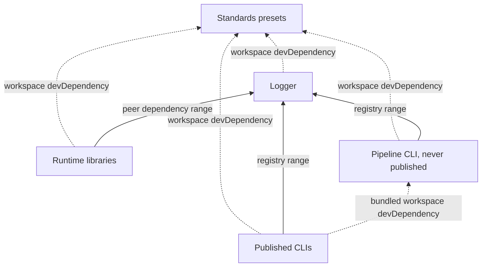

# AGENTS.md

These are the rules for changing core, for people and agents alike. Each package adds its own `AGENTS.md` with the rules local to it, and this file owns every rule shared by all packages.

## What the project guarantees

A change that weakens one is wrong, even when it compiles.

1. **Only the pipeline publishes a package.** It publishes from `main`, with provenance, at a version computed from commits. A version published by hand has no tag, so the next computed version can collide with it, and consumers lose the link from the npm page back to the commit.
2. **Pipeline jobs read credentials from the vault only.** The `load-secrets` command of the pipeline CLI loads them. GitHub secrets feed only the transitional vault seeding workflow. A credential then rotates in one place for every repository.
3. **A job that can log in to the vault runs core's code only.** Any step of a job granted `id-token: write` can mint the token the vault accepts, so caller code in such a job could read every secret. [The infrastructure docs](packages/infrastructure/README.md) draw this boundary and name its single exception.
4. **`main` changes only through pull requests.** Every project calls core's workflows at `@main`, and the vault trusts core's workflows on `main` only. A direct push would ship to every project and bypass that trust.
5. **The infrastructure package is never published.** The workflows run it from a checkout of core. A package that needs its code bundles it at build time.
6. **A published manifest installs from npm alone.** semantic-release publishes with `npm publish`, which does not rewrite the `workspace:` protocol, so `workspace:*` appears only in `devDependencies`.
7. **The dependency graph between packages has no cycle, and the standards package sits at its base.** Turbo builds every dependency before its dependents and refuses a cyclic graph.

## Architecture rules



- **Keep the standards package free of workspace dependencies.** Every other package extends it, so any edge out of it closes a cycle.
- **Log through `@nextnode-solutions/logger`, and keep the logger free of runtime dependencies.** Every package and every project installs it, and one logger keeps log format and routing the same everywhere.
- **Depend on the infrastructure package only as a `devDependency` that your build bundles.** It is never published, so a runtime dependency on it cannot install. The worker types CLI uses its library export this way.
- **Give a runtime or peer dependency on another core package a semver range of a published version.** pnpm then installs that version from the registry, not the workspace copy. A change to the dependency reaches the dependent only after it is released and the range admits it, so release the dependency first and raise the range in a later change.
- **Keep the infrastructure package's runtime dependencies on the registry.** The setup action installs it from a sparse checkout of core that holds only that package and the lockfile, where a workspace link cannot resolve.
- **Declare a core package as a peer dependency, plus a `workspace:*` devDependency, when your public API accepts or returns its types.** The consumer then supplies one shared copy. The email manager does this with the logger.
- **Put pipeline logic in a command of the pipeline CLI, and call it from a workflow step.** The logic is then typed, linted and shared by every workflow. The infrastructure package's `AGENTS.md` explains how to add a command.
- **Start every pipeline job with the shared setup action.** Its infra mode installs the pipeline CLI and its deps mode installs the calling project's dependencies, so each job gets exactly what it runs.
- **Keep project installs, builds and scripts out of any job granted `id-token: write`.** The deploy workflow builds the project in a job with no credential and ships the uploaded result.
- **Treat a merge to `main` as a release of the platform.** A change to the pipeline CLI or the setup action goes live for every project at once. Core's own pull requests run the CLI from `main`, so their pipeline never exercises the change. Verify it with the package checks before merging.

## Code rules

The formatter and linter rules live in the standards presets, wired in through each package's `oxfmt.config.ts` and `oxlint.config.ts`. lint-staged sorts every staged `package.json`. The rules below are the ones no tool enforces.

- **Write code, comments, docs and commit messages in English.** Every NextNode project reads them.
- **Add a rule meant for every project to the standards preset, never to one package's config.** Projects get the shared rules only through the presets.
- **Extend the standards preset in every tool config, and override only what the package alone needs.** The logger turns off the console rule because writing to the console is its job. Each config follows one pattern:
    - `tsconfig.json` extends `@nextnode-solutions/standards/typescript/library`.
    - `oxlint.config.ts` passes the standards oxlint config to `extends`.
    - `oxfmt.config.ts` re-exports `@nextnode-solutions/standards/oxfmt`.
    - `tsdown.config.ts` spreads the standards tsdown preset and sets the entries.
    - `vitest.config.ts` merges a standards Vitest preset with the package's test patterns.
- **Name package scripts after the root Turbo tasks: `build`, `lint`, `test`, `format` and `format:check`.** A script under another name never runs from the root or in CI. A TypeScript package also has `type-check`, which runs `tsgo --noEmit`.
- **Give every manifest the shared fields.** Each package sets `name` as `@nextnode-solutions/<directory>`, `version`, `description`, `license`, `author`, `repository` with the package `directory`, `files`, `type` set to `module`, and the `engines` and `packageManager` of the root manifest. A published package adds `publishConfig`, `homepage` and `keywords`. A library adds `exports` and `sideEffects`. A CLI adds `bin`.
- **Never bump a `version` field by hand.** The release writes the version inside the CI checkout and commits nothing back. The tag and the npm registry hold the published version.
- **List the build and coverage output in the package's own `.gitignore`.** oxfmt reads only the ignore file of the directory it runs in, so without one `format:check` scans the build output and fails.
- **Keep a shared tool's version specifier identical in every manifest that declares it, and change them all in one commit.** The standards presets assume one version of oxlint, oxfmt, oxlint-tsgolint, tsdown and `@typescript/native-preview`.
- **List a dependency in `onlyBuiltDependencies` of `pnpm-workspace.yaml` when it needs its install script.** pnpm skips the install scripts of every unlisted dependency, so a native binding would install broken.
- **Keep git hooks, the commitlint config and the lockfile at the root.** Husky runs the root hooks, and pnpm installs the whole workspace from the root lockfile.
- **Never edit generated files.** Change the source and rebuild instead. Generated files include build output, husky's internal hook directory and the formatter preset that the standards build copies from its TypeScript source.

## Checks

Every commit must pass these, run from the repository root:

```sh
pnpm build
pnpm lint
pnpm test
pnpm format:check
pnpm -r type-check
```

- **Run them yourself before you push.** A pull request runs the checks of the packages it touches and nothing else. A change outside `packages/`, or to a package others depend on, can break the build with every check green.
- **Never bypass the hooks with `--no-verify`.** The `commit-msg` hook runs commitlint, `pre-commit` runs lint-staged on the staged files, and `pre-push` runs the tests. Fix what they report.
- **Check one package with `pnpm --filter @nextnode-solutions/<package> <script>`.** To reproduce a CI quality task, which builds the package's workspace dependencies first, run `pnpm turbo run <task> --filter=@nextnode-solutions/<package>`.

## Commits

- **Write conventional commits.** The `commit-msg` hook enforces the commitlint preset of the standards package, which owns the allowed types and the length limits.
- **Scope a commit with the package directory name.** An example is `fix(infrastructure): stop serving source maps`. For a change outside `packages/`, name the area, as in `ci(runners): restore ubuntu-latest`. The scope is for readers, and the release ignores it.
- **Choose the type as a release decision.** A `feat`, `fix` or `perf` commit that touches a package directory publishes that package. Use `docs`, `test`, `refactor`, `style`, `build`, `ci` or `chore` for a change that must not publish. The changed paths select the package.
- **Mark a breaking change with a `BREAKING CHANGE:` footer.** The release preset parses headers with the Angular convention, which does not read `!` after the type. A `feat!:` header passes commitlint and releases nothing.
- **Make one commit per package when a change spans several.** Each commit's paths decide which packages it releases, and each package gets its own release notes.
- **Keep every commit valid, not only the pull request title.** Pull requests merge with a merge commit, so each commit lands on `main` and semantic-release reads it.

### Branches and pull requests

- **Branch from `main` as `<type>/<kebab-summary>`, with the conventional type of the change.** An example is `fix/public-build-settings-and-sentry`. The branch name then says what the merge will release.
- **Merge through a pull request with a merge commit, never a push to `main`.** The push to `main` releases each touched package that has a releasable commit, and puts every platform change live.

## Documentation

- **Give the root and every package a `README.md` and an `AGENTS.md`, and never add a `CLAUDE.md`.** The README explains the project to people. `AGENTS.md` is the only rules file, and every coding agent reads it. Put a guide under a `docs/` folder only when a part has moving parts that the README cannot hold.
- **Keep monorepo rules in the root docs only.** A package's docs state what is specific to the package and link to the root for the rest.
- **Write docs that stay true while the code grows.** Describe roles, rules, flows, lifecycles and failure outcomes. Never write a list of files or modules, a path into the source, a value copied from code or config, a count, a version, a date, a line number or a word like "currently". Name code by its role. User-facing names stay concrete: package names, export subpaths, CLI commands, config files and keys, and the workflow files a caller references.
- **Draw diagrams in Mermaid only.** GitHub renders them, and they stay editable.
- **Never commit plans, notes, specs, audit reports, interview records or delivery reports.** They describe a moment, go stale with the next change, and an agent that finds them reads them as instructions. Git history and pull requests keep what a past change decided.

> **The docs describe the intended behavior.** That covers `docs/`, the README and the `AGENTS.md` files. When a change makes them wrong, do not just rewrite them to match. First check that the change is expected: the task asks for it, or the user confirms it.
>
> - If it is expected, update the docs in the same commit as the change.
> - If it is not, the docs win. Bring the code back in line with them, or stop and ask.

## Working against real systems

Some actions change shared state or cannot be undone. Each needs the user's go-ahead first, and a cleanup afterwards when one is possible.

- **Merging a releasable commit publishes to npm.** npm never accepts the same version number twice, so a bad release is fixed by a new one, not by a cleanup.
- **Merging to `main` changes the pipeline of every NextNode project** on its next run.
- **Dispatching the teardown workflow destroys a project's Workers and resources.** With data wipe enabled it also destroys its databases and buckets.
- **Dispatching the vault seeding workflow writes into the vault.**
- **Running a pipeline CLI command with real credentials changes Cloudflare, Terraform state, PlanetScale or pull request comments.** Run it only through CI, on an isolated target, never from a local machine, and remove what it created afterwards. Local credentials are for read-only inspection.
- **Pushing a tag or creating a GitHub release by hand** shifts the base from which every later version is computed.

## Extending

### Add a package

1. Create a kebab-case directory under `packages/`. Its npm name is `@nextnode-solutions/<name>`.
2. Write its manifest with the shared fields and the Turbo script names. Give `version` a placeholder, as the infrastructure package does. Add the standards package as a `workspace:*` devDependency, and each tool you use at the specifier the other manifests use.
3. Add one config per tool, each extending its standards preset, and a `.gitignore` for the build and coverage output.
4. Add a `nextnode.toml`. Its `[project]` section sets `name` to the directory name, `type = "package"` and `filter` to the npm name. Set a `[scripts]` entry to `false` for each quality task the package lacks. Add `[package]` with `access = "public"` when the package is published.
5. Add a `.releaserc.json` that extends `semantic-release-monorepo` and `@nextnode-solutions/standards/semantic-release`, with `tagFormat` set to `@nextnode-solutions/<name>-v${version}`. Skip it for a package that is never published.
6. Copy an existing package's workflow to `.github/workflows/<name>.yml`, and change its name, both path filters and its `config_file` input.
7. Write the package's `README.md` and `AGENTS.md`.
8. Run `pnpm install` and commit the updated lockfile with the package.
9. Run the checks.
10. With the user's go-ahead, merge a `feat(<name>): ...` commit that touches the package directory. It publishes the first version.

### Add a dependency

1. Run `pnpm --filter @nextnode-solutions/<package> add <dependency>`, with `-D` for a tool or test dependency.
2. Follow the specifier rules above when the dependency is a core package.
3. Allow its install script in `pnpm-workspace.yaml` when it needs one.
4. Commit the lockfile with the manifest.

### Change a shared tool version

1. Change the specifier in every manifest that declares the tool, the root one included.
2. Raise the standards package's peer dependency range for that tool when its presets need the new version.
3. Run `pnpm install`, then the checks.

### Add a workflow that projects call

1. Write the logic as a pipeline CLI command, following the infrastructure package's `AGENTS.md`.
2. Add the workflow under `.github/workflows/`, triggered by `workflow_call`, with explicit `permissions` and the vault variables of the existing reusable workflows.
3. Start each job with the setup action, and load credentials with `load-secrets`.
4. Document its inputs and the permissions a caller grants in the infrastructure docs.
