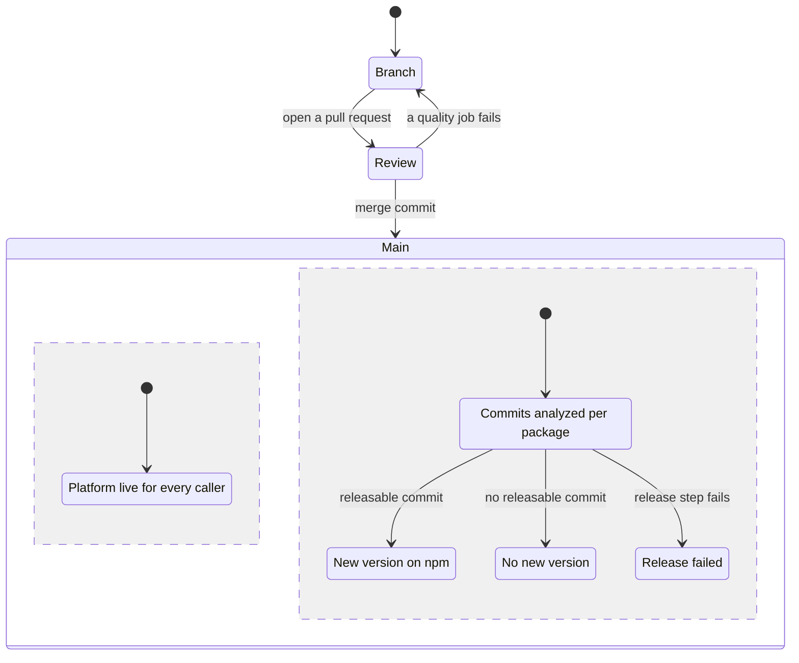

# NextNode core

Core is the NextNode Solutions monorepo. It publishes the shared `@nextnode-solutions` npm packages, and it hosts the CI/CD platform that every NextNode repository calls from its GitHub workflows, so projects reuse one set of standards, libraries and pipelines instead of copying them.

The packages come in four kinds. The standards package holds the lint, format, TypeScript, build, test, commit and release presets that every project extends. Runtime libraries, such as the logger and the email manager, are imported by application code. The brand assets package ships logos and icons as plain files. Command-line tools run either inside a project, like the worker types generator, or inside the pipeline, like the infrastructure CLI, which is never published. Each package explains itself in its own README under [packages](packages).

## Quick start

Use a Node version within the `engines` range of the root `package.json`, and the pnpm version its `packageManager` field pins. Corepack provides that pnpm.

```sh
pnpm install
pnpm build
pnpm test
```

`pnpm install` also installs the git hooks. Build before anything else, because packages import the built output of the packages they depend on.

## How it works



1. A NextNode project installs core's packages from npm and calls core's reusable workflows, such as `deploy.yml` and `plan-diff.yml`, at `@main`.
2. A change reaches core through a pull request. The workflow of each package the pull request touches runs that package's lint and test.
3. The merge to `main` puts any workflow or pipeline CLI change live at once, because every caller runs core's `main`.
4. For each package the merge touched, semantic-release reads the commits that changed the package since its last tag. A `feat`, `fix`, `perf` or breaking commit publishes a new version with provenance, a git tag and a GitHub release.

[The architecture guide](docs/architecture.md) follows the release pipeline and the reusable workflows step by step, with what each failure leaves behind. [The infrastructure docs](packages/infrastructure/README.md) explain how a project deploys, how the vault holds the credentials and where the trust boundary lies. [AGENTS.md](AGENTS.md) holds the rules for contributing, for people and agents alike: checks, commit format, dependency rules and how to add a package.
