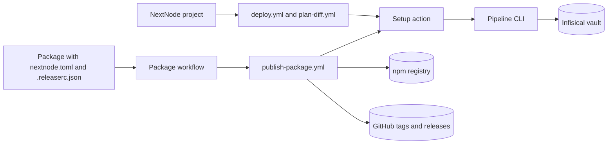
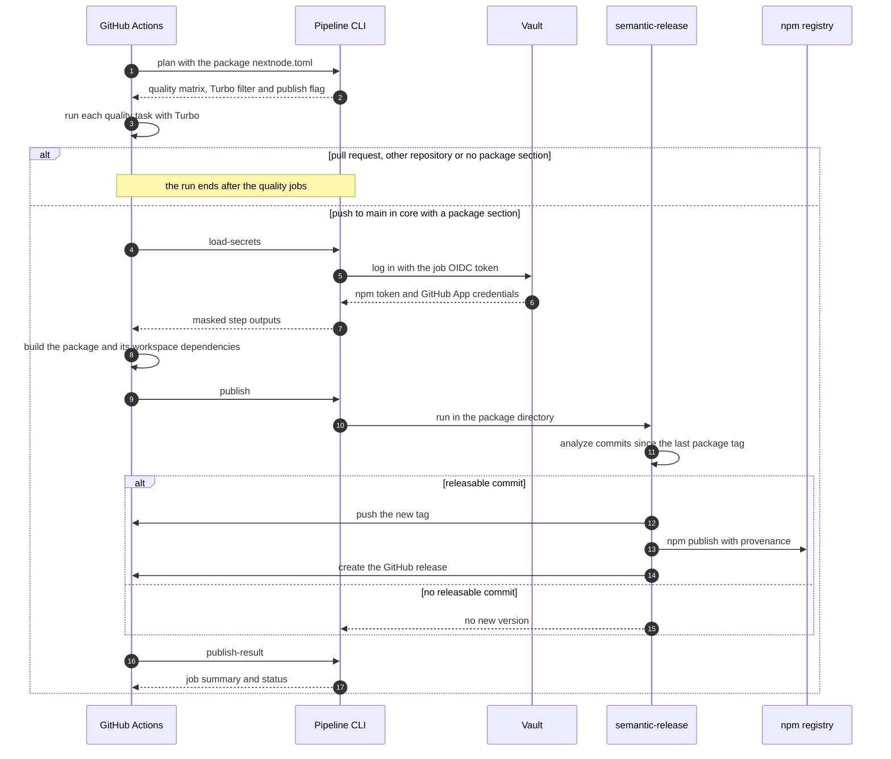
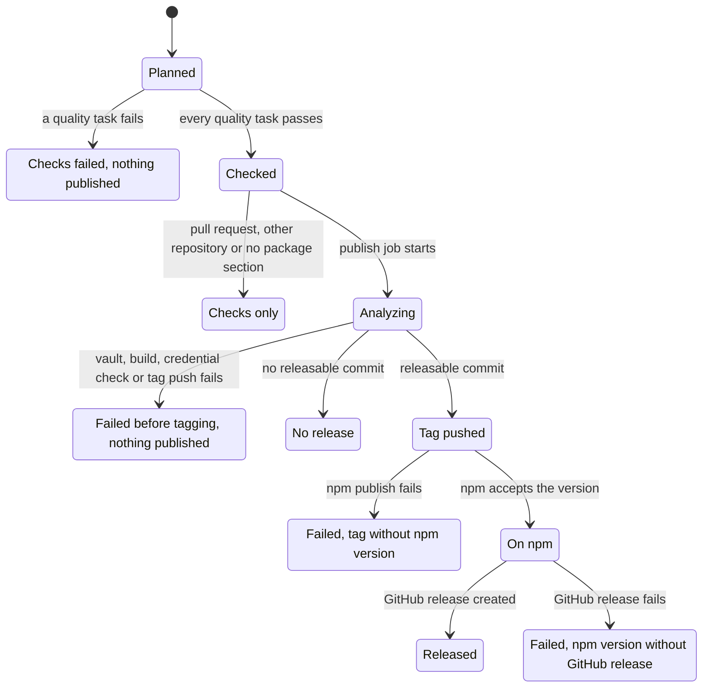
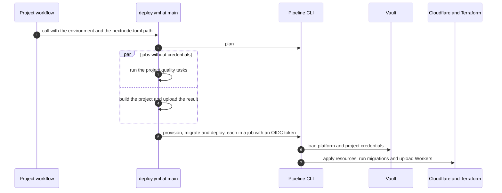

# Architecture

This guide explains how core releases its own packages and how it serves the CI/CD platform that NextNode projects call. It follows each run step by step and says what every failure leaves behind.

## Parts

- A package declares itself to the pipeline with a `nextnode.toml` and configures its release with a `.releaserc.json`.
- A package workflow, named after the package directory, runs when a change touches that directory. It calls `publish-package.yml` with the package's `nextnode.toml`.
- `publish-package.yml` checks the package, then releases it. It refuses to publish for any repository but core.
- `deploy.yml` and `plan-diff.yml` are the workflows that NextNode projects call. Core also holds a teardown workflow and a vault seeding workflow that people dispatch by hand.
- The setup action starts every job. It checks out the calling repository, installs pnpm and Node, and then installs either the pipeline CLI from a checkout of core, the calling project's dependencies, or both.
- The pipeline CLI is the infrastructure package, run from that checkout. Workflow steps call its commands, so the pipeline logic is typed and linted code rather than shell in YAML.
- The vault holds every credential the pipeline uses. A job logs in with its GitHub OIDC token.

## Boundaries

| Boundary                      | Contract                                                                                                                                                                                                                                                                                                                                                                                 |
| ----------------------------- | ---------------------------------------------------------------------------------------------------------------------------------------------------------------------------------------------------------------------------------------------------------------------------------------------------------------------------------------------------------------------------------------- |
| Package to pipeline           | `nextnode.toml` gives `[project]` with `name`, `type = "package"` and the npm name as `filter`. `[scripts]` renames or disables the `lint` and `test` quality tasks. `[package]` with `access` marks the package as published. `.releaserc.json` extends `semantic-release-monorepo` and `@nextnode-solutions/standards/semantic-release`, and sets a `tagFormat` unique to the package. |
| Workflow to CLI               | A step runs one CLI command from the core checkout. Environment variables on the step carry the inputs. The command answers through step outputs and the job summary, and signals failure with a non-zero exit.                                                                                                                                                                          |
| Job to vault                  | The `load-secrets` command trades the job's OIDC token for vault access and exposes each credential as a masked step output. Only core's workflows on `main` can log in.                                                                                                                                                                                                                 |
| Publish job to npm and GitHub | semantic-release publishes with the npm token from the vault and with provenance from the job's OIDC token. It pushes tags and creates releases with a GitHub App token minted from vault credentials.                                                                                                                                                                                   |
| Project to reusable workflow  | A project calls a workflow at `@main` and grants the permissions that workflow documents. [The infrastructure docs](../packages/infrastructure/README.md) own the inputs, the permissions and the trust boundary.                                                                                                                                                                        |

## A package workflow run

1. The plan job reads the package's `nextnode.toml` and turns each enabled quality task into a Turbo run filtered to the package. A package with no quality task gets a placeholder task that passes.
2. The quality jobs run in parallel on the installed core tree. One failing task does not cancel the others.
3. The publish job runs only for a push to `main` in core, or a manual run on `main`, when the package has a `[package]` section. Releases of one package queue behind each other.
4. Before semantic-release runs, the job drops its local tags and fast-forwards to the remote `main`, so the release sees the current tags and the latest commit.
5. `publish-result` reads the semantic-release output, writes the job summary and fails the job when the output shows neither a release nor a skipped release.

## How a version is computed

1. `semantic-release-monorepo` keeps only the commits that change a file under the package directory, and only the tags that match the package's `tagFormat`.
2. The latest matching tag on `main` marks the last release. A package with no tag gets semantic-release's first version.
3. The commit analyzer reads each header with the Angular convention. A `BREAKING CHANGE:` footer bumps the major version, `feat` the minor version, and `fix` or `perf` the patch version. Other types release nothing. The largest bump wins.
4. The npm plugin writes the version into the package manifest inside the CI checkout, then semantic-release tags the commit, pushes the tag, publishes to npm and creates the GitHub release.
5. Nothing is committed back. The `version` field in git is not the published version. The tag and the npm registry hold it.

The commit scope plays no part. Only the changed paths and the commit type do.

## Release lifecycle

## Failure and what is left

| Failure                                                             | What is left                                                                                                                                                              |
| ------------------------------------------------------------------- | ------------------------------------------------------------------------------------------------------------------------------------------------------------------------- |
| A quality task fails                                                | Nothing is published. The publish job does not run.                                                                                                                       |
| Vault login, credential load or build fails                         | Nothing is published and no tag exists.                                                                                                                                   |
| semantic-release rejects its npm or GitHub credentials              | Nothing is published and no tag exists.                                                                                                                                   |
| The tag push is rejected                                            | Nothing is published, because semantic-release pushes the tag before it publishes.                                                                                        |
| npm publish fails after the tag push                                | A tag with no npm version. The next release counts from that tag, so this version number is never published.                                                              |
| The GitHub release fails after npm publish                          | The version is on npm and tagged, with no GitHub release, and the job fails.                                                                                              |
| The output shows a version published to npm and a rejected git push | The CLI rebases on `main`, moves the tag to the new head and pushes both again, within a retry limit. If every attempt fails, the version stays on npm and the job fails. |
| The output matches no known outcome                                 | The job fails and its summary reports a failed publish.                                                                                                                   |

## A project's deploy

The caller's code builds in a job that holds no credential. The jobs that can log in to the vault run core's CLI only, apart from the one exception the infrastructure docs name, and ship the uploaded build. A merge to core's `main` changes the next run of every project, because every project calls the workflow at `@main` and the setup action checks out the CLI from `main`. For the same reason, a pull request in core runs the CLI from `main`, not from its own branch. [The infrastructure docs](../packages/infrastructure/README.md) cover the deploy in full.

## Guarantees

- Every version on npm was built and published by the publish job, from core's `main`, with provenance.
- Each package versions on its own. Its tag format is unique, and only commits that touch its directory count.
- Pipeline jobs take their credentials from the vault, never from the caller.
- A job that can log in to the vault runs core's code, apart from the single exception the infrastructure docs name.
- Every project runs the same platform, the one on core's `main`.
