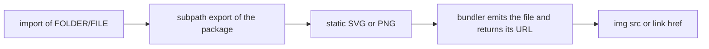

# @nextnode-solutions/brand-assets

The NextNode Solutions logos, icons, favicons and social avatars, published as static SVG and PNG files behind subpath exports. Front-end projects import them instead of keeping their own copies, so new artwork reaches every project through a dependency upgrade.

## Quick start

```bash
pnpm add @nextnode-solutions/brand-assets
```

```ts
import logoUrl from '@nextnode-solutions/brand-assets/logos-landscape/logo-landscape-teal.svg'
```

## How it works



1. A project imports a file by its folder and file name.
2. The package's subpath exports map that path to the static file. There is no code and no build step in between.
3. The bundler copies the file into the project's output and hands back its URL.
4. The page uses that URL wherever an image URL goes.

The package declares no side effects, so a bundler drops any asset a project imports but never uses.

## Import paths

Each kind of asset has its own folder, and each folder is a subpath of the package:

```text
@nextnode-solutions/brand-assets/FOLDER/FILE
```

The folder name is the kind in the plural, and each file in it starts with the kind in the singular, as in `logos-landscape/logo-landscape-teal.svg`. A folder without a subpath export does not resolve.

File names follow this pattern:

```text
KIND[-VARIANT][-short][-mini].EXT
```

- `VARIANT` is the color of the mark, or the background theme of a social avatar. The favicon has none.
- `-short` marks the landscape logo that reads "NextNode" without "Solutions".
- `-mini` marks the small PNG. An SVG never carries it.
- `EXT` is `svg` or `png`.

The suffixes always come in this order, as in `logo-landscape-teal-short-mini.png`. A design ships as an SVG, a full PNG for high-density screens and a mini PNG drawn at the SVG's own size. List a folder in the installed package to see the files a kind provides.

## Usage

### With a bundler

Vite and Astro turn an image import into the URL of the emitted file. Other bundlers need an asset rule for `.svg` and `.png`.

```ts
import logoUrl from '@nextnode-solutions/brand-assets/logos-landscape/logo-landscape-teal.svg'

const logo = document.createElement('img')
logo.src = logoUrl
logo.alt = 'NextNode Solutions'
document.body.append(logo)
```

TypeScript needs a module declaration for image imports. Vite provides one through the `vite/client` types, and Astro through `astro/client`.

### In React

```tsx
import logoUrl from '@nextnode-solutions/brand-assets/logos-landscape/logo-landscape-teal.svg'

export function SiteLogo() {
	return 
}
```

Use the file as an image URL, not as an inline SVG component. Every SVG in the package names its gradient with the same id, so two variants inlined into one page would both paint with the gradient of the first.

### In Astro

```astro
---
import { Image } from 'astro:assets'
import logo from '@nextnode-solutions/brand-assets/logos-landscape/logo-landscape-teal.png'
---

<Image src={logo} alt="NextNode Solutions" height={40} />
```

Astro reads the PNG's size from the import and generates the optimized image.

### In plain HTML

Without a bundler, serve the files yourself. The installed package keeps them under its `src` folder, with the same folder and file names as the import paths. Copy the ones you need into the site's static directory:

```bash
mkdir -p public/brand
cp node_modules/@nextnode-solutions/brand-assets/src/favicon/favicon.svg public/brand/
cp node_modules/@nextnode-solutions/brand-assets/src/logos-landscape/logo-landscape-teal.svg public/brand/
```

```html
<link rel="icon" type="image/svg+xml" href="/brand/favicon.svg" />

```

A public npm CDN serves the same files under the same paths inside the package.

## Choosing a variant

- Use teal by default, on light backgrounds.
- Use white on dark backgrounds.
- Use black for monochrome print.
- Use a `-short` landscape logo when the full wordmark does not fit.
- Use the SVG on the web. Use a PNG only where a raster is required, the mini PNG for small placements and the full PNG where a high-resolution image is needed.
- Use a social avatar for a profile picture. It carries its own opaque background. Pick dark or light to match the platform.

The wordmarks are live SVG text, not outlined shapes. They render in the brand font only where that font is available, and fall back to a system sans-serif elsewhere.

## Contributing

[AGENTS.md](AGENTS.md) holds the rules for adding a kind or a variant, the naming rules, the checks and how the package is released. The [root README](../../README.md) covers the monorepo.
