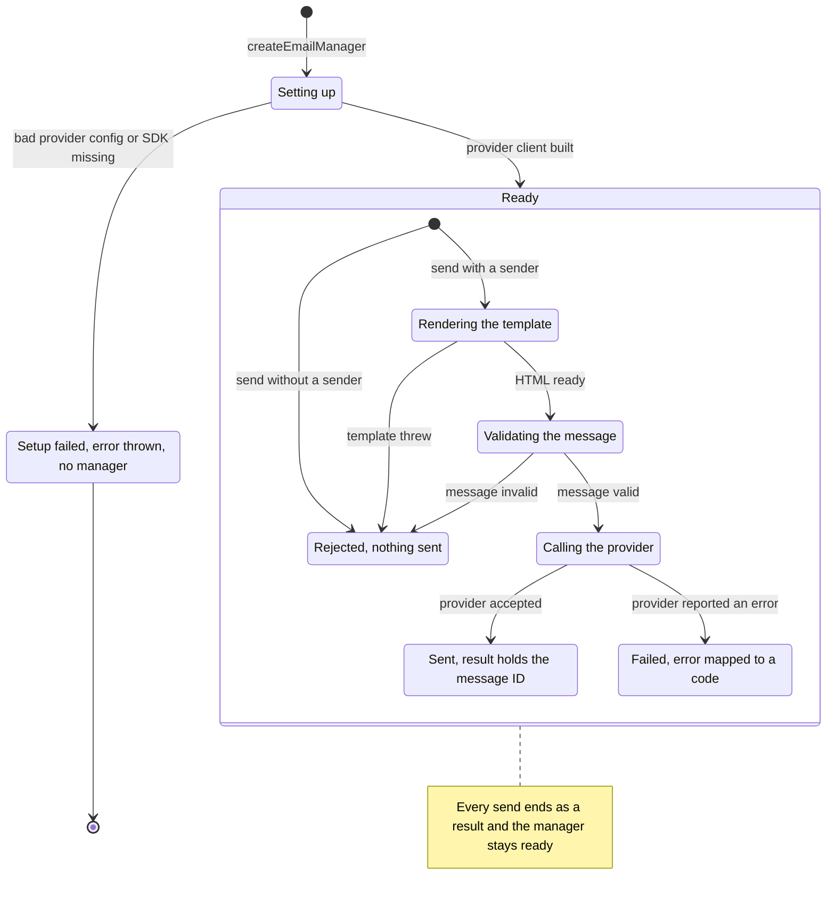

# @nextnode-solutions/email-manager

Sends transactional email from React Email templates. You pass a template and its props, the library renders HTML and plain text and hands the message to an email provider, and each send resolves to a typed result instead of throwing.

## Quick start

```bash
pnpm add @nextnode-solutions/email-manager @nextnode-solutions/logger @react-email/render react resend
```

Everything the library imports at runtime is a peer dependency, so your application picks the versions. `resend` is an optional peer, needed only when you send through Resend.

A template is any function that takes props and returns a React element. Components from `@react-email/components` work, and so does plain JSX.

```tsx
import type { ReactElement } from 'react'

export interface WelcomeEmailProps {
	name: string
}

export function WelcomeEmail({ name }: WelcomeEmailProps): ReactElement {
	return (
		<html lang="en">
			<body>
				<p>Welcome to NextNode, {name}.</p>
			</body>
		</html>
	)
}
```

Create one manager at startup, then send.

```ts
import { createEmailManager } from '@nextnode-solutions/email-manager'

import { WelcomeEmail } from './welcome-email.js'

const apiKey = process.env.RESEND_API_KEY
if (!apiKey) {
	throw new Error('RESEND_API_KEY is not set')
}

const emails = await createEmailManager({
	provider: 'resend',
	providerConfig: { apiKey },
	defaultFrom: 'NextNode <noreply@example.com>',
})

const result = await emails.send({
	to: { email: 'ada@example.com', name: 'Ada' },
	subject: 'Welcome to NextNode',
	template: WelcomeEmail,
	props: { name: 'Ada' },
})

if (!result.success) {
	throw new Error(
		`Email failed: ${result.error.code} ${result.error.message}`,
	)
}

console.log(`Sent ${result.data.id} through ${result.data.provider}`)
```

TypeScript infers the props type from `template`, so props that do not match the template fail to compile. A failed send carries an `EmailError` with a `code` from the `EmailErrorCode` union, a readable `message`, and the provider name and the caught error when there is one.

The package also exports lower-level entry points. `renderTemplate` returns the HTML and text of a template without sending, which suits previews and snapshot tests. `createProvider` returns a bare provider whose `send` takes an already rendered `EmailMessage`. A manager also exposes its provider as `emails.provider` and offers `emails.validateConfig()` for a credentials check.

```ts
import {
	createProvider,
	renderTemplate,
} from '@nextnode-solutions/email-manager'

const rendered = await renderTemplate(WelcomeEmail, { name: 'Ada' })

const resend = await createProvider('resend', { apiKey })
const sent = await resend.send({
	from: 'noreply@example.com',
	to: 'ada@example.com',
	subject: 'Pre-rendered body',
	html: '<p>Hello Ada</p>',
})
```

## How it works



1. `createEmailManager` asks the provider registry for the named provider. The registry checks the provider config, loads that provider's SDK on demand and builds one client. A bad config or a missing SDK throws here.
2. `send` picks the sender. The message's `from` wins over `defaultFrom`, and a send with neither is rejected.
3. The template renderer turns the template and its props into HTML and plain text. A template that throws becomes a `TEMPLATE_ERROR` result.
4. The provider validates the message, maps it to its SDK payload and calls the SDK once.
5. The provider maps the SDK response into a `SendResult`. The manager logs the outcome and returns that result unchanged.

[docs/architecture.md](docs/architecture.md) has the parts, one sequence per operation, what each failure leaves behind and the guarantees. [docs/configuration.md](docs/configuration.md) explains each option and what happens when you omit it. [docs/providers/resend.md](docs/providers/resend.md) covers how messages and errors cross the Resend boundary.

## Contributing

Rules for changing this package, its checks and the steps to add a provider are in [AGENTS.md](AGENTS.md). The shared monorepo workflow, including releases, is in the [root README](../../README.md) and the [root AGENTS.md](../../AGENTS.md).
