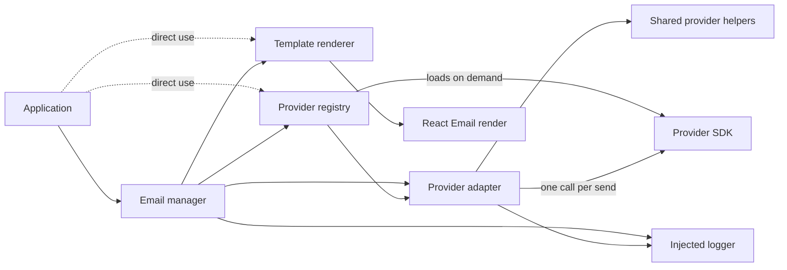
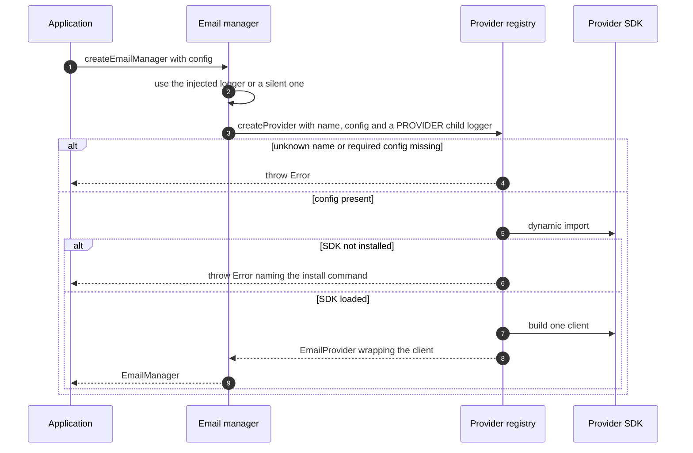
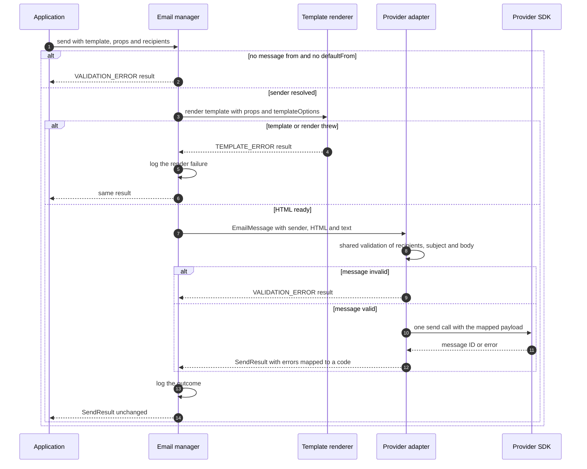
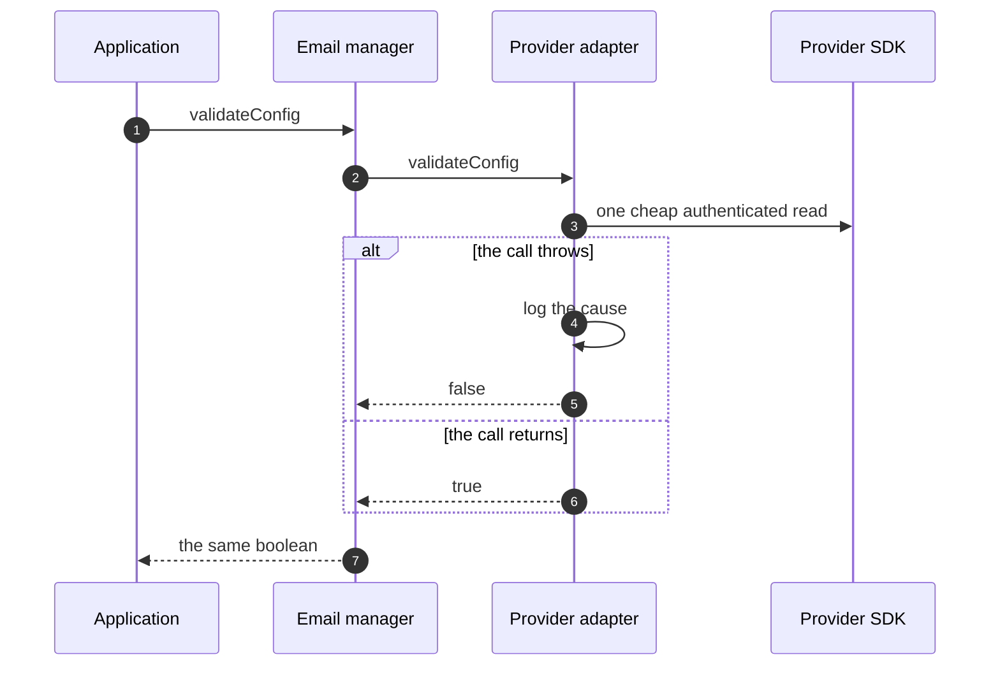

# Architecture

This page explains how the library is split into parts, what each boundary promises, what happens during each operation and what a failure leaves behind. The lifecycle of a manager and of one send is the state diagram in the [README](../README.md#how-it-works).

## Parts

The email manager is the object `createEmailManager` returns. It resolves the sender, asks the renderer for HTML, hands the rendered message to the provider adapter and logs the outcome. It knows providers only through the `EmailProvider` interface.

The template renderer is `renderTemplate`. It calls the template function with the props, then renders the returned element to HTML, and to plain text unless `templateOptions` turns that off. Because the template is called as a plain function, a hook in the template's own body throws. Components nested in the returned tree render normally.

The provider registry is `createProvider`. It maps a provider name to a setup routine. It is the only part that loads a provider SDK, and it does so with a dynamic import, so an application never needs the SDK of a provider it does not use.

A provider adapter implements `EmailProvider` for one provider. It receives a built SDK client and a logger, validates each message with the shared provider helpers, maps it to the SDK payload and maps the SDK answer back to a `SendResult`. The shared helpers format recipients and enforce the rules every provider needs, such as a cap on `to` recipients.

## Boundary contracts

| Boundary                                                 | Contract                                                                                                                                                                                                                          |
| -------------------------------------------------------- | --------------------------------------------------------------------------------------------------------------------------------------------------------------------------------------------------------------------------------- |
| Application to `createEmailManager` and `createProvider` | Returns a ready manager or provider, or rejects with an `Error`. Setup checks that the provider config is present, not that the credentials work.                                                                                 |
| Application to `send`                                    | Resolves to a `SendResult` for every outcome. It rejects only when the injected logger throws.                                                                                                                                    |
| Manager to renderer                                      | Resolves to the HTML and optional text, or to a `TEMPLATE_ERROR` result. It never throws.                                                                                                                                         |
| Manager to registry                                      | Given a name, its config and a child logger, returns an `EmailProvider` or throws.                                                                                                                                                |
| Manager to adapter                                       | Given an `EmailMessage` with a resolved sender and a rendered body, resolves to a `SendResult`. The manager returns that result unchanged.                                                                                        |
| Adapter to SDK                                           | The adapter imports only the SDK's types and receives the client from the registry. It turns every SDK error, returned or thrown, into an `EmailError` that carries the provider name and, when there is one, the original error. |
| Any part to the logger                                   | Entries carry message IDs, recipient counts, error codes and error messages. The library writes no addresses, subjects, bodies or keys.                                                                                           |

## Operations

### Set up a manager

The manager keeps that one client for its whole life. Every send reuses it.

### Send an email

A successful send produces two success log entries. The adapter writes one under the `PROVIDER` scope, and the manager writes one under the logger it was given.

### Check credentials

Each adapter decides what counts as a failed read. The Resend adapter treats only a thrown error as a failure, which [docs/providers/resend.md](providers/resend.md#check-credentials) explains.

## Failure and what is left

| Failure                                                                                                     | How it surfaces                                                             | What is left                                                                                       |
| ----------------------------------------------------------------------------------------------------------- | --------------------------------------------------------------------------- | -------------------------------------------------------------------------------------------------- |
| Unknown provider name, or required provider config missing                                                  | `createEmailManager` or `createProvider` rejects with an `Error`            | No manager and no client. Nothing was sent.                                                        |
| Provider SDK not installed                                                                                  | The same rejection, with a message naming the install command               | No manager and no client. Nothing was sent.                                                        |
| No `from` on the message and no `defaultFrom`                                                               | `VALIDATION_ERROR` result                                                   | Nothing rendered, nothing logged, nothing sent.                                                    |
| The template function or the React Email render throws                                                      | `TEMPLATE_ERROR` result holding the original error                          | Nothing sent. The manager logged the render failure.                                               |
| The message fails shared validation, such as no recipients, too many `to` recipients, no subject or no body | `VALIDATION_ERROR` result                                                   | The SDK was not called.                                                                            |
| The SDK reports or throws an error                                                                          | Failure result with a mapped code, the provider name and the original error | The library did not retry. After a network error the provider may still have accepted the message. |
| `validateConfig` sees a failed read                                                                         | Resolves `false` and logs the cause                                         | The manager stays usable.                                                                          |
| The injected logger throws                                                                                  | `send` rejects with that error                                              | If the logger threw while logging the outcome, the email may already be sent.                      |

## Guarantees

1. Setup either returns a manager with a built provider client or throws. It never returns a manager without a provider.
2. `send` resolves to a `SendResult` for every outcome, as long as the injected logger does not throw.
3. Nothing reaches the provider SDK before the sender resolves, the template renders and the message passes validation.
4. Each `send` makes at most one SDK call. The library never retries.
5. A manager builds its provider client once and reuses it for every send.
6. A provider's SDK loads only when that provider is set up.
7. The library reads no environment variables and no files. Credentials arrive only through `providerConfig`.
8. The library's own log entries contain no addresses, subjects, bodies or keys. Error messages from a provider are logged as received.
