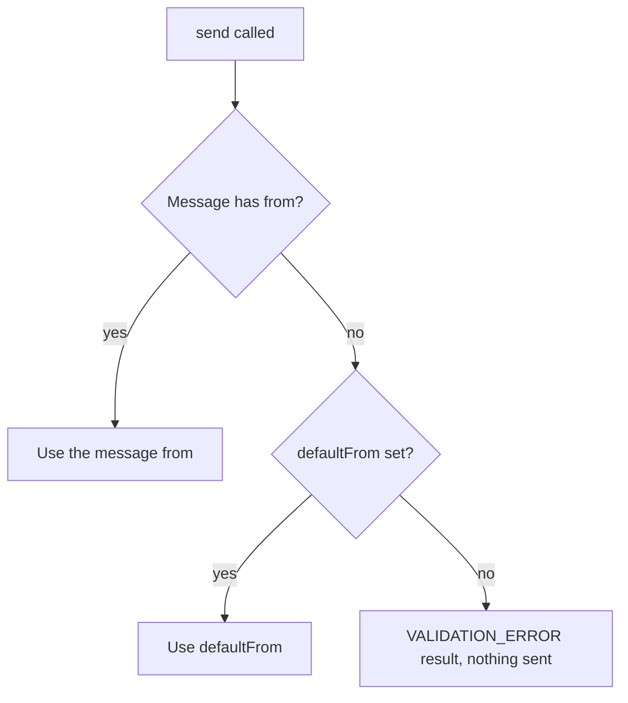

# Configuration

This page explains the options `createEmailManager` accepts, what happens when you leave one out and how a mistake is reported. Every option arrives as an argument. The library reads no environment variables and no files, so your application loads secrets and passes them in.

## Sender precedence

The sender is the only option a message can override. Render options and the logger apply to every send of a manager.

## Options

| Option            | What it controls                                                                                                        | When omitted                                     | How a mistake is reported                                                                                                 |
| ----------------- | ----------------------------------------------------------------------------------------------------------------------- | ------------------------------------------------ | ------------------------------------------------------------------------------------------------------------------------- |
| `provider`        | Which provider adapter the registry builds. The keys of `ProviderConfigMap` are the accepted names.                     | Required.                                        | An unknown name fails to compile. From untyped code it throws at setup.                                                   |
| `providerConfig`  | The provider's settings. TypeScript types it from `provider`.                                                           | Required.                                        | A missing required setting throws at setup. A wrong credential is only reported by the first send or by `validateConfig`. |
| `defaultFrom`     | The sender for messages without a `from`. It is a string that reaches the provider as given.                            | Each message must carry its own `from`.          | A send with no sender resolves to a `VALIDATION_ERROR` result.                                                            |
| `templateOptions` | The `TemplateRenderOptions` used for every render, such as pretty-printed HTML or the plain-text version.               | Each render option takes the renderer's default. | Not validated.                                                                                                            |
| `logger`          | Where log entries go. Pass a `@nextnode-solutions/logger` instance, typed by the `Logger` type this package re-exports. | A silent logger, so nothing is printed.          | Not validated.                                                                                                            |

Each provider has a page that describes its own settings. For Resend, see [providers/resend.md](providers/resend.md).

## Setup errors versus send errors

Mistakes that make every send impossible throw from `createEmailManager`, so they surface when the application boots. These are an unknown provider name, a missing required provider setting and an uninstalled provider SDK. Mistakes that concern one message, such as a missing sender, resolve to a failure result from `send` and leave the manager usable.
