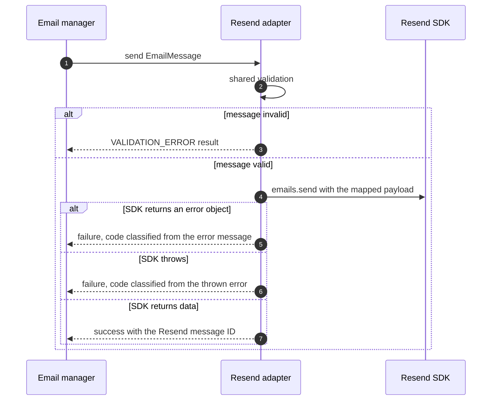
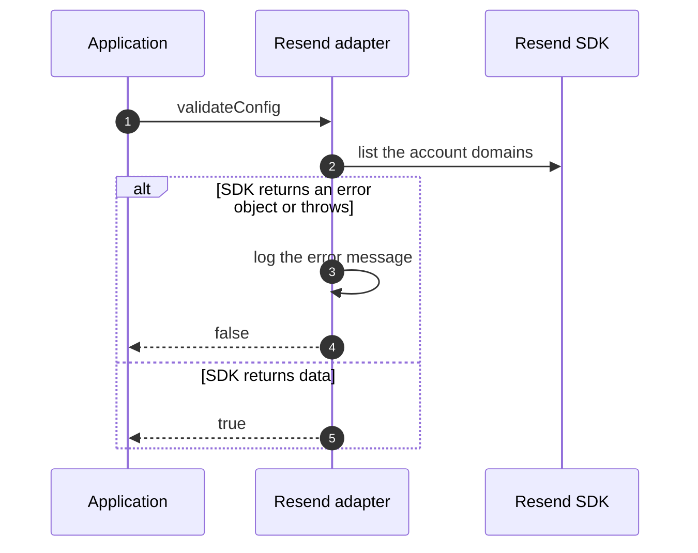

# Resend provider

This page explains how the Resend adapter turns an `EmailMessage` into a Resend request, and how Resend's answer becomes a `SendResult`.

## Setup

Install the optional peer `resend`, then select the provider by name and pass the API key.

```ts
const emails = await createEmailManager({
	provider: 'resend',
	providerConfig: { apiKey },
})
```

`providerConfig` takes the fields of `ResendProviderConfig`, of which `apiKey` is required. The provider registry rejects an empty or blank key before it loads the SDK. The Resend SDK reads the `RESEND_API_KEY` environment variable when it gets no key, and this check means that fallback never runs. When `resend` is not installed, setup throws an error that names the install command.

## What crosses the boundary

| Message field                        | What Resend receives                                                                                                               |
| ------------------------------------ | ---------------------------------------------------------------------------------------------------------------------------------- |
| `from`, `to`, `cc`, `bcc`, `replyTo` | Each recipient as a string. An `{ email, name }` recipient becomes `Name <email>`. Every field except `from` goes out as an array. |
| `subject`, `html`                    | Unchanged.                                                                                                                         |
| `text`, `attachments`, `tags`        | Forwarded when present and left out otherwise. Attachment content and content type pass through unchanged.                         |
| `headers`                            | The list of name and value pairs becomes a single header object.                                                                   |
| `scheduledAt`                        | A `Date` becomes an ISO 8601 string. A string passes through unchanged.                                                            |

The adapter sends no idempotency key. A caller that retries after a network error can therefore deliver the same email twice.

## Send



The Resend SDK reports API errors and network failures in its return value. It throws only on unexpected errors. Both paths go through the same classification.

Classification lowercases the error message and checks it against an ordered set of keyword rules, one rule per error code, where the first match wins. An unmatched error becomes `PROVIDER_ERROR`. A thrown value that is not an `Error` becomes `UNKNOWN_ERROR`. Some codes replace Resend's message with a generic one. Every failure except a validation failure carries `resend` as its `provider`.

Classification reads only the message text. For an error that Resend returns, the adapter wraps the message in a new `Error` and keeps that as `originalError`, so Resend's status code and error name are dropped. A change in Resend's wording can move an error to `PROVIDER_ERROR`.

## Check credentials



The check resolves `false` when Resend rejects the key, when Resend cannot be reached and when the SDK throws. A key restricted to sending also fails it, because Resend refuses such a key the domain list.
