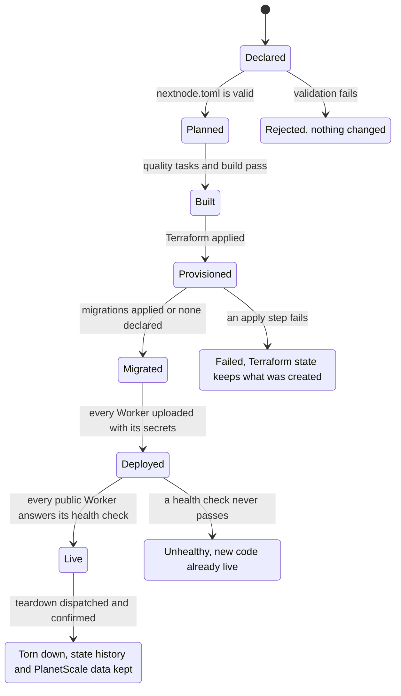

# Infrastructure

`@nextnode-solutions/infrastructure` is the CLI that NextNode's reusable GitHub Actions workflows run to deploy a project to Cloudflare Workers. It turns the project's `nextnode.toml` into infrastructure and Worker configuration, and it reads every credential from the Infisical vault, so a project repository holds no deployment code and no secret.

## Quick start

A project never installs this package. It calls the reusable deploy workflow of core:

```yaml
permissions:
    contents: read
    actions: read
    id-token: write

jobs:
    deploy:
        uses: NextNodeSolutions/core/.github/workflows/deploy.yml@main
        with:
            environment: development
```

It describes its Workers and backing services in `nextnode.toml` at the repository root:

```toml
[project]
name = "my-app"
type = "app"
domain = "example.com"

[deploy.services.web]
url = "example.com"
needs = ["d1"]

[services.d1]
```

[Configuration](docs/configuration.md) explains every table of that file. [GitHub Actions](docs/github/actions.md) covers the workflow inputs, permissions and organization settings. Worker secrets come from the repository's own Infisical project, set up as described in [the Infisical vault](docs/infisical/vault.md). For typed bindings in Worker code, the app adds [`@nextnode-solutions/worker-types`](../worker-types/README.md), which bundles this package's `./worker-types` export.

## How it works

A project environment moves through these states on each run of the deploy workflow.



1. `plan` validates `nextnode.toml` and decides which quality tasks run.
2. The quality tasks and the project's build run. The build job holds no credential.
3. `provision` makes sure the Terraform state workspace and any PlanetScale database exist, then applies Terraform.
4. `migrate-remote` applies database migrations when the project declares a database.
5. `deploy` uploads each Worker with Wrangler, syncs its secrets from the vault and calls its health endpoint.

[Architecture](docs/architecture.md) follows each command step by step and lists what a failure leaves behind. The integrations have their own pages: [Cloudflare Workers](docs/cloudflare/workers.md), [HCP Terraform](docs/hcp/terraform.md), [the Infisical vault](docs/infisical/vault.md), [PlanetScale](docs/planetscale/database.md) and [GitHub Actions](docs/github/actions.md).

## Release

This package is never published to npm. Workflows run its source from core's `main` branch, so a merge to `main` reaches every caller's next run. The `./worker-types` export reaches apps only through a release of `@nextnode-solutions/worker-types`.

## Contributing

[AGENTS.md](AGENTS.md) holds the layer rules, conventions, extension steps and checks for this package. Monorepo setup and the shared release flow are in the [root README](../../README.md).
