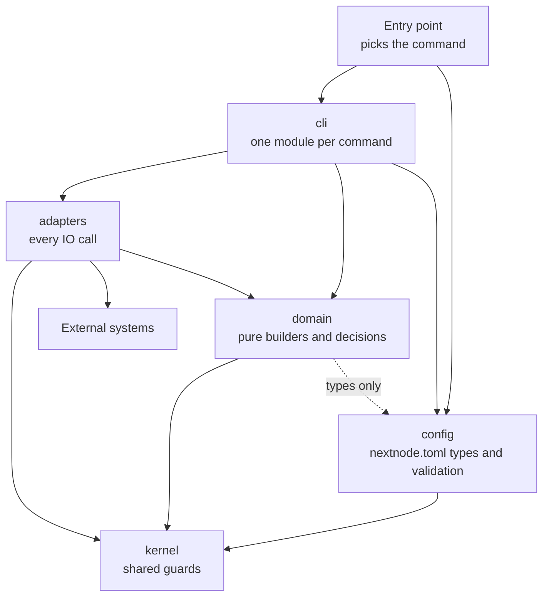
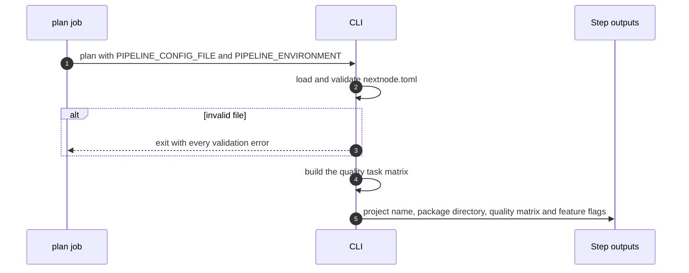
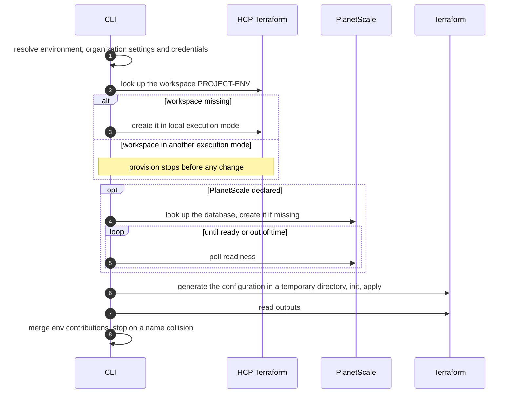
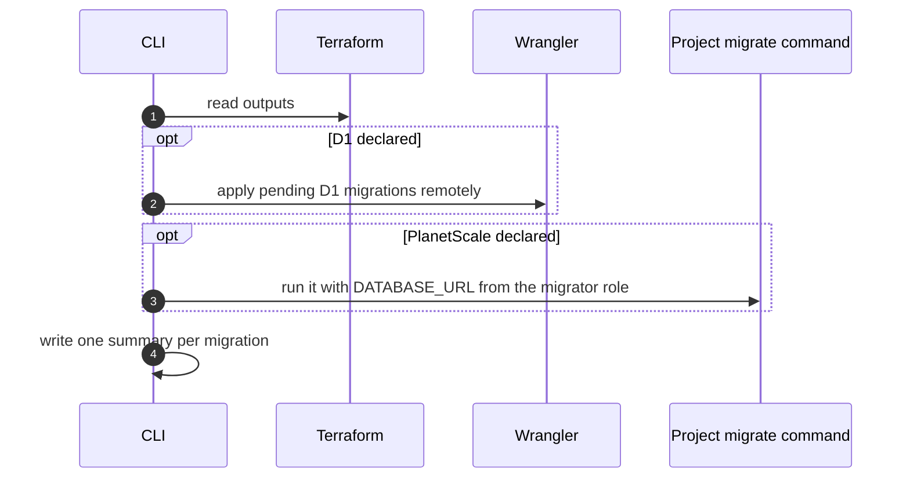
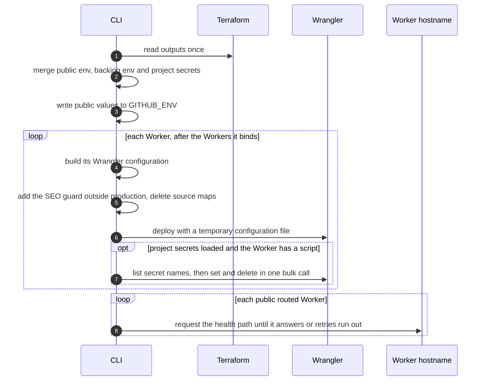
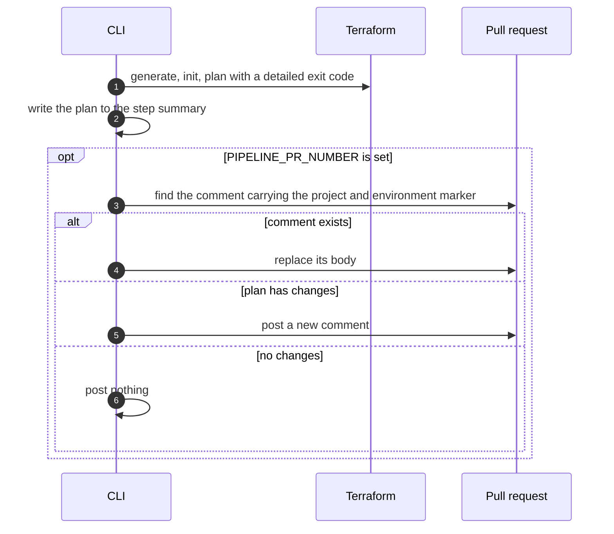
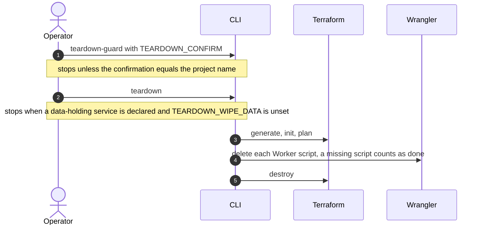
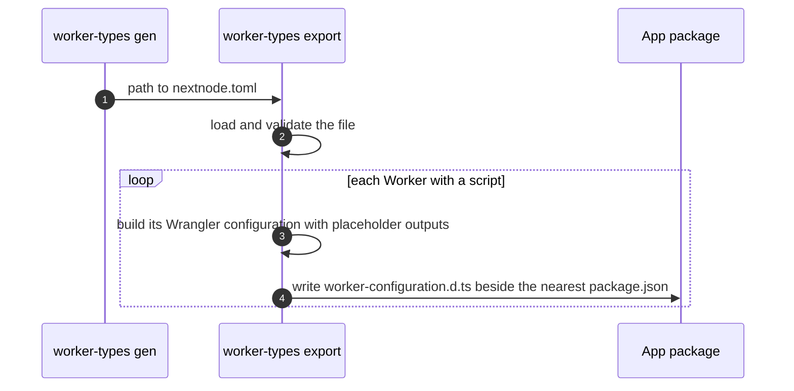
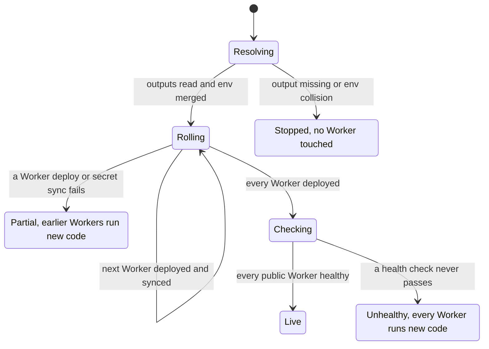

# Architecture

This page explains how the CLI is split, what each command does from start to end, and what a failure leaves behind.

## Parts

The entry point reads the command name, loads `nextnode.toml` when the command needs it, and calls the command. A command reads its environment variables, asks `domain` for every decision and document, and asks `adapters` for every call to the outside. `domain` never performs IO, so the same builders serve a deploy in CI and type generation on a developer machine. `config` turns the TOML file into typed sections and knows nothing about Cloudflare. `kernel` holds the few helpers every layer shares.

## Boundary contracts

- **Entry point to command.** A standalone command runs without `nextnode.toml`. A plan command receives any valid project. A deploy command receives only a deployable project, and the entry point skips it with a log line for any other project type. The config path comes from `PIPELINE_CONFIG_FILE`. Running the CLI with no command lists the commands.
- **Command to environment.** Commands read their settings from environment variables that the workflow sets. A missing required variable stops the command with an error that names it, before any external call.
- **Config to the rest.** Loading returns a fully validated, typed config or throws one error that lists every problem found. Nothing downstream re-validates the file.
- **Domain.** Builders take the config, the environment and the organization settings, and return plain data: the Terraform configuration, one Wrangler configuration per Worker, resource names, summaries as markdown, and decisions such as whether to post a pull request comment.
- **Adapters.** Each adapter talks to one external system and returns owned types. A failed call throws with the status or exit code and the response body or stderr. The deploy target adapter composes the others.
- **Deploy target.** Every target implements one interface: contribute public env, ensure infrastructure, load backing env, deploy, migrate, tear down and plan. A registry maps the target name to its factory.
- **Job to job.** A job passes data to the next through GitHub step outputs. Public values go to `GITHUB_ENV`. Secrets travel only as masked step outputs.
- **The `./worker-types` export.** It takes a path to `nextnode.toml` and returns the type files it wrote. It reads no environment variable and writes no GitHub output, because it runs on developer machines.

## Commands

### plan

The quality matrix holds the project's lint and test scripts, the D1 check command when one is declared, and the production gate. The gate runs in production when the development environment is enabled. It fails unless the development workflow succeeded for the same commit.

### provision

[HCP Terraform](hcp/terraform.md) and [PlanetScale](planetscale/database.md) explain why the workspace and the database are created outside Terraform.

### migrate-remote

D1 migrations run against the generated configuration of the first Worker that binds D1. Wrangler applies only the migrations the remote database lacks, so the step runs on every deploy.

### deploy

### plan-infra

### teardown-guard and teardown

Workers go first so no traffic reaches resources that Terraform is about to destroy.

### generate-worker-types

The CLI command of the same name does the same from CI. Type generation runs before provision, so the builders receive placeholder resource ids. Only binding and var names reach the type file.

The remaining commands belong to other workflows. `load-secrets` is described in [the Infisical vault](infisical/vault.md). `prod-gate`, `publish` and `publish-result` are described in [GitHub Actions](github/actions.md).

## A deploy run

## Failures and what they leave

| Failure                                                | What is left                                                                                                                                                 |
| ------------------------------------------------------ | ------------------------------------------------------------------------------------------------------------------------------------------------------------ |
| `nextnode.toml` is invalid                             | Nothing ran. The error lists every problem.                                                                                                                  |
| A required variable or organization setting is missing | The command stopped before any external call.                                                                                                                |
| The HCP workspace is not in local execution mode       | Nothing applied. The workspace must be switched by hand.                                                                                                     |
| The PlanetScale database is not ready in time          | The database exists or is still being created. Terraform did not run. The next provision reuses it.                                                          |
| `terraform apply` fails                                | HCP state records what was created. The next run converges from there.                                                                                       |
| The Terraform state lock stays held                    | Terraform waited for a bounded time, then failed with a hint on how to release the lock.                                                                     |
| A migration fails                                      | Workers keep their previous version, because the deploy job needs a successful migrate job.                                                                  |
| A Worker's deploy or secret sync fails                 | Workers earlier in the order run the new code. That Worker and later ones keep what they had, except a failed sync leaves the new code with the old secrets. |
| A health check never passes                            | Every Worker runs the new code. The job is red.                                                                                                              |
| The repository has no Infisical project                | The deploy succeeds with a warning. Worker secrets stay as they were.                                                                                        |
| Teardown fails after deleting Workers                  | Workers are gone. Terraform resources remain until teardown runs again.                                                                                      |

## Guarantees

1. A scripted Worker holds exactly the secrets of its repository's Infisical environment after a deploy that loaded them. A static-assets-only Worker holds none.
2. No secret reaches `GITHUB_ENV`, a log line, a step summary, a subprocess argument or the build job.
3. The project's own code never runs in a job that can log in to the vault, except a PlanetScale migration command.
4. Terraform and Wrangler never manage the same resource.
5. The generated types and the deployed Wrangler configuration come from the same builders.
6. Generated configuration is deterministic for a given `nextnode.toml` and environment.
7. Generated Terraform and Wrangler files live in temporary directories that each command removes.
8. Development and production never share a resource, a Worker script or a rate limiter counter.
9. Terraform, Wrangler, GitHub CLI and migration subprocesses, the PlanetScale readiness poll and the health checks are bounded in time. Other calls rely on the job's timeout.
10. Teardown needs a typed confirmation, refuses to destroy data without `wipe_data`, and keeps the Terraform state history and the PlanetScale database.
