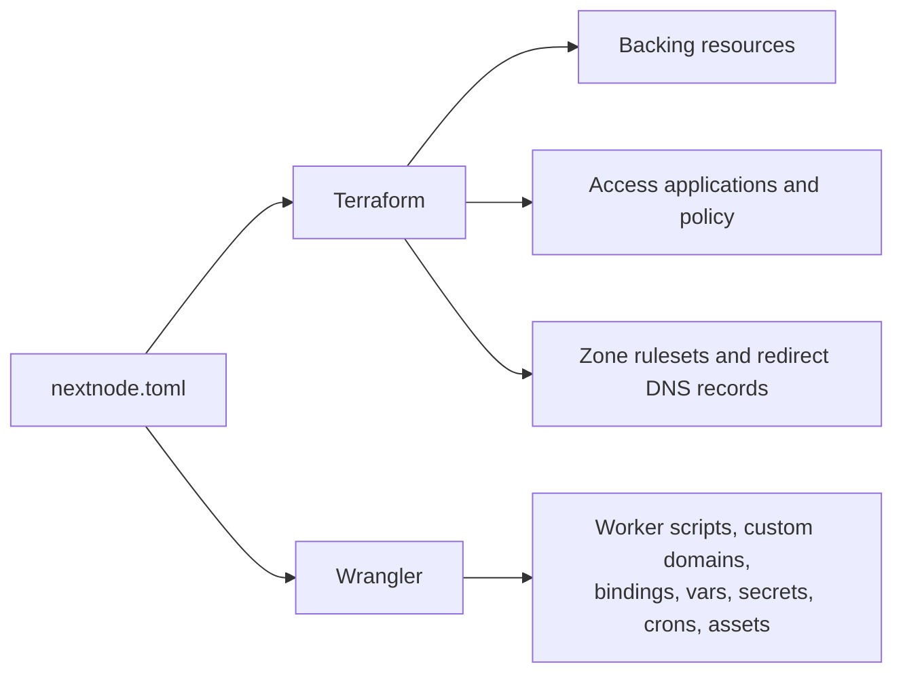
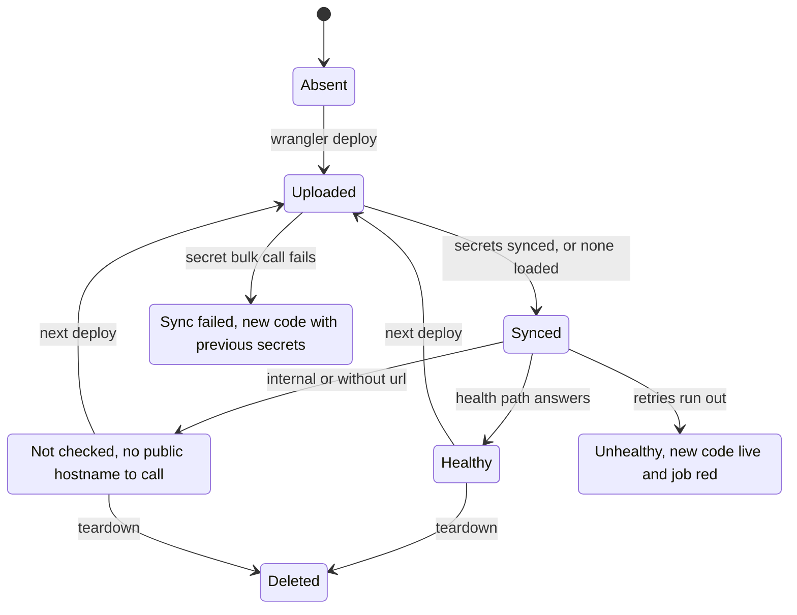
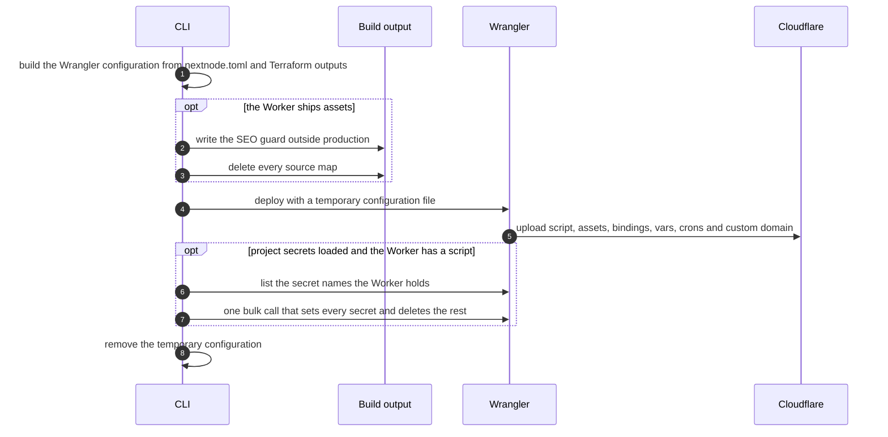

# Cloudflare Workers

This page explains what the CLI creates on Cloudflare, which tool owns each part, and how a Worker goes from a build output to a live hostname.

## Setup

The CI project of the vault holds `CLOUDFLARE_API_TOKEN` and `CLOUDFLARE_ACCOUNT_ID`. The token needs, on the account, Workers Scripts Edit and Account Settings Read, and on each routed zone, Workers Routes Edit, DNS Edit and Zone Read. It also needs edit rights on every kind of backing resource the projects declare. A project with an internal Worker needs the Access Apps and Policies permission. When Cloudflare rejects the token, the error repeats the Workers permissions to check.

Every zone the projects use, `project.domain` and each redirect domain, must already exist in the account. The CLI looks zones up and never creates them.

## Who owns what

Terraform and Wrangler never manage the same resource. Terraform creates what Workers depend on, and its outputs give Wrangler the ids to bind. Wrangler owns everything attached to a Worker script, so a Worker's code and its bindings always change together in one upload. [HCP Terraform](../hcp/terraform.md) explains how the Terraform side runs.

Every name carries the project and the environment. A Worker script is named `PROJECT-ENV-SERVICE`, and backing resources follow the same pattern with their own name. Development and production therefore never share a resource.

A deploy uploads the Workers the file declares and deletes nothing. Renaming or removing a Worker in `nextnode.toml` leaves the old script running under its old name until someone deletes it.

## A Worker's lifecycle

## Deploying one Worker

Workers deploy one at a time, each after the Workers it binds, because a service binding needs its target script to exist. A failed upload stops the run, so later Workers keep their previous version.

The generated configuration follows these rules:

- **No `workers.dev` hostname.** A routed Worker answers only on its custom domain, and any other Worker only through service bindings.
- **Bindings follow `needs`.** A Worker binds only the backing resources and siblings it lists, and its vars carry the ids of exactly those resources.
- **Sibling Workers talk through service bindings.** No Worker receives another Worker's URL.
- **Workers Logs are on** unless the Worker sets `observability = false`.
- **The runtime version and compatibility flags are pinned** in the CLI for every Worker, so a deploy behaves the same from run to run. Changing them is a reviewed change to the CLI.
- **Source maps never ship.** Anything in an assets directory is public, and a source map holds the original source.
- **Non-production deploys are not indexable.** Outside production the assets directory gets headers and a `robots.txt` that ask crawlers to stay away.

## Health checks

After every Worker is deployed, the CLI requests `/healthz` on each public routed Worker. The app must answer it with a success status. The CLI retries within a time budget, because a new custom domain needs DNS and an edge certificate before it answers. Each attempt has its own time limit, so a request that never completes counts as a failed attempt. A Worker that never answers fails the job, with the last status and body in the log, while the new code stays live.

Internal Workers are not checked, because CI has no Access login. Check their login redirect by hand after a change to Access.

## Internal Workers and Access

An internal Worker gets one self-hosted Access application per environment, on its environment's hostname. One allow policy per project and environment admits the company's email domain, with the session lifetime from the organization settings described in [GitHub Actions](../github/actions.md#organization-settings).

The Worker receives the application's audience tag as the public var `ACCESS_AUD`. It verifies the `Cf-Access-Jwt-Assertion` header against that audience and the organization's Zero Trust team domain. Keep `ACCESS_AUD` out of the repository's Infisical project, since the deploy already sets it as a var.

## Zone rules

Zone rules exist in production only. A zone has one ruleset per phase, so a development deploy would overwrite production's rules.

- **`rate_limit`** becomes a rate limiting rule on the Worker's host. It counts requests per client IP and data centre and answers Too Many Requests with a JSON body. It acts before the Worker runs, so blocked requests cost nothing.
- **`public_paths`** becomes a firewall rule that blocks every other path on the host.
- **`redirect_domains`** each get proxied placeholder DNS records for the apex and `www`, plus a permanent redirect to the project's site that keeps the path and query string. The records exist only so the redirect runs at Cloudflare's edge.

The configuration validator rejects more zone rules than the Cloudflare Free plan allows per zone, so the apply never fails on that limit.

## R2 public buckets

A bucket with `cdn = true` gets a custom domain `NAME.cdn.DOMAIN` under the environment's hostname. The Worker receives the bucket's public URL as a var. A private bucket is reachable only through the Worker's binding.

## D1 migrations

`migrate-remote` runs Wrangler's remote D1 migration against the configuration of the first Worker that binds D1, using the `migrations_folder` of `[services.d1]`. Wrangler applies only the migrations the remote database lacks. A project that declares D1 needs at least one Worker with `needs = ["d1"]`.

## Teardown

Teardown deletes every Worker script of the project's environment first, then runs `terraform destroy`. A script that is already gone counts as deleted, so a teardown can run again after a partial failure. Destroying a backing service that holds data requires the `wipe_data` input.
