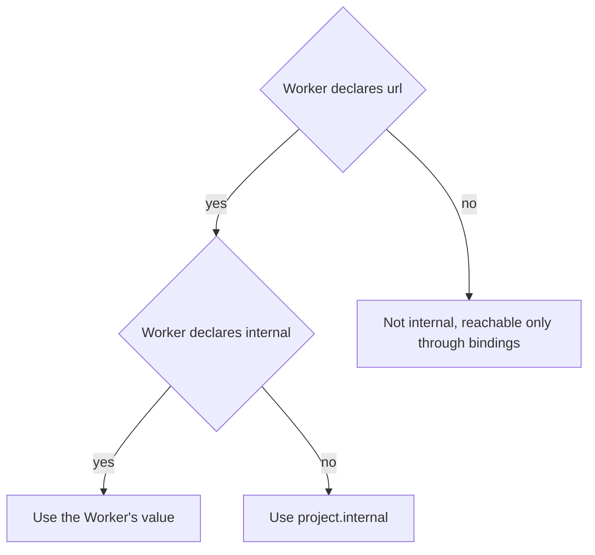

# Configuration

A project describes itself in one `nextnode.toml`. This page explains where the file lives, what each table declares, how values combine, and how mistakes are reported.

## Where the file lives

The file sits in the project's repository. The `config_file` input of the reusable workflows gives its path, and the repository root is the default. A monorepo app points `config_file` at its own directory, such as `apps/web/nextnode.toml`.

Paths inside the file, such as a Worker's `entry` or `assets`, resolve against the directory that holds it. Only that directory travels from the build job to the deploy job, so everything a Worker ships must sit under it.

## Tables

### `[project]`

| Key                | Meaning                                                                                                                                           |
| ------------------ | ------------------------------------------------------------------------------------------------------------------------------------------------- |
| `name`             | Kebab-case identifier. It prefixes every resource, Worker script and state workspace of the project.                                              |
| `type`             | Whether and how the project deploys. A `package` project takes neither `[deploy]` nor `[services]`, and only an `app` project takes `[services]`. |
| `domain`           | The Cloudflare zone the project deploys to. Required for a deployable project.                                                                    |
| `filter`           | The workspace filter the quality tasks pass to Turborepo. Without it they run the root scripts.                                                   |
| `redirect_domains` | Other zones whose apex and `www` redirect to `domain`, in production only.                                                                        |
| `internal`         | The default `internal` of every routed Worker. It requires at least one Worker with a `url`.                                                      |

### `[scripts]` and `[environment]`

`scripts.lint` and `scripts.test` name the scripts the quality jobs run. Set one to `false` to skip it. `environment.development = false` declares that the project has no development environment, so a production deploy skips the gate that waits for a successful development run.

### `[package]`

Its presence marks a package that the publish workflow releases. Only core's own packages use it, because that workflow publishes nothing for another repository.

### `[deploy]`

`target` names the platform the project deploys to. Without it, the project's type picks its default target, so most projects leave it out. A value the pipeline does not implement fails validation with the list of accepted targets. The table also holds the Worker and cron tables below.

### `[deploy.services.NAME]`

Each table declares one Worker. `NAME` is kebab-case and becomes part of the Worker's script name.

| Key             | Meaning                                                                                                                                                                                                       |
| --------------- | ------------------------------------------------------------------------------------------------------------------------------------------------------------------------------------------------------------- |
| `url`           | The hostname the Worker answers on, equal to `project.domain` or under it, and unique across Workers. Without `url` the Worker is reachable only through service bindings.                                    |
| `internal`      | Puts a routed Worker behind Cloudflare Access. See [precedence](#how-internal-is-decided).                                                                                                                    |
| `entry`         | The built bundle. It defaults to the server entry the Astro Cloudflare adapter emits. `entry = false` makes a static-assets-only Worker, which runs no code and requires `assets`.                            |
| `assets`        | The built assets directory of a static-assets-only Worker, and valid only with `entry = false`. A scripted Worker's assets directory comes from its `entry`, following the Astro Cloudflare adapter's layout. |
| `needs`         | Backing services and sibling Workers the Worker binds. A sibling becomes a service binding, and the Worker deploys after it.                                                                                  |
| `depends_on`    | Sibling Workers that must deploy first, without a binding.                                                                                                                                                    |
| `observability` | Workers Logs, on unless set to `false`.                                                                                                                                                                       |
| `rate_limit`    | A zone rate limiting rule on the Worker's host, in production only. It blocks bursts at Cloudflare's edge before the Worker runs, so blocked requests are not billed.                                         |
| `public_paths`  | A production firewall rule that blocks every path of the host except these. An empty list blocks the whole host. Leaving the key out adds no rule.                                                            |
| `limits`        | Per-invocation CPU and subrequest ceilings. Without it the generated config sets none, because the Workers Free plan rejects a CPU limit.                                                                     |
| `rate_limiters` | Named Rate Limit bindings the Worker calls itself, after the request is billed. Each counter is private to the project, environment and Worker.                                                               |

A path in `rate_limit` or `public_paths` is exact, or ends with `*` to match a prefix.

### `[[deploy.cron]]`

Each entry adds a Cron Trigger. `schedule` is a standard cron expression. `service` names the Worker that receives it, and the first declared Worker receives it otherwise. The Worker implements the scheduled handler. `path` and `method` are validated but the generated config does not carry them, so they have no effect on Cloudflare. When this table is present, no Worker may be named `cron`.

### `[services]`

Each table under `[services]` declares one backing service of the project, shared by the Workers that list it in `needs`.

| Table                    | Declares                                                                                                                                                               |
| ------------------------ | ---------------------------------------------------------------------------------------------------------------------------------------------------------------------- |
| `[services.d1]`          | One D1 database. `migrations_folder` holds its migrations, and `check_command` adds a quality task.                                                                    |
| `[services.kv]`          | KV namespaces, each with a `name`.                                                                                                                                     |
| `[[services.queues]]`    | Queues, each with a `name`. Workers bind them as producers.                                                                                                            |
| `[services.r2]`          | R2 buckets, each with a `name`. `cdn = true` serves a bucket publicly on `NAME.cdn.DOMAIN`, where `DOMAIN` is the environment's hostname.                              |
| `[services.planetscale]` | One PlanetScale Postgres database reached through Hyperdrive. `migrate_command`, `cluster_size` and `region` are optional. See [PlanetScale](planetscale/database.md). |

A Worker with `needs = ["planetscale"]` implies `[services.planetscale]` even when the table is absent.

Secrets are never declared here. Every scripted Worker receives the whole Infisical environment of its repository, as [the Infisical vault](infisical/vault.md) explains.

## What a Worker receives

A Worker binds only what its `needs` lists. The binding name of a resource derives from its name, upper-cased with dashes turned into underscores, plus a prefix for its kind. Run `worker-types gen` to see the exact names in the generated `worker-configuration.d.ts`.

Its public vars carry `SITE_URL`, the ids and names of the backing resources it needs, and `ACCESS_AUD` when it is internal. `SITE_URL` uses the Worker's own `url` and falls back to `project.domain`. A static-assets-only Worker receives no var and no secret.

## How internal is decided

A Worker's own `internal` wins in both directions, so an internal project can keep a webhook receiver public. Setting `internal = true` on a Worker without `url` is an error.

## Development and production

The workflow's `environment` input picks the environment. Development hostnames get a `dev.` prefix, and every resource name carries the environment. Zone rules from `rate_limit`, `public_paths` and `redirect_domains` exist in production only. A zone holds one ruleset per phase, so the two environments would overwrite each other's rules.

## How mistakes are reported

Every command that reads the file validates it before it calls anything outside. Validation collects every problem, and the error lists them with the key path of each, such as `deploy.services.web.url`. Beyond types, it checks references across tables: a `needs` or `depends_on` entry must name a declared service or Worker, a Worker cannot need itself, and the number of zone rules stays within what the Cloudflare Free plan allows per zone. A key that no longer exists, such as a `secrets` list or a container-only field, is rejected with a message that says what to do instead. A `depends_on` or binding cycle passes validation and stops the deploy, naming the Workers involved.
