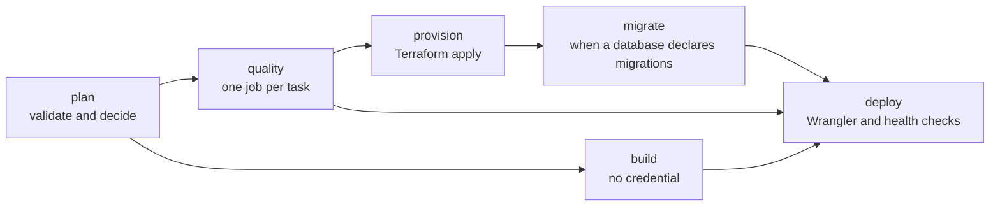
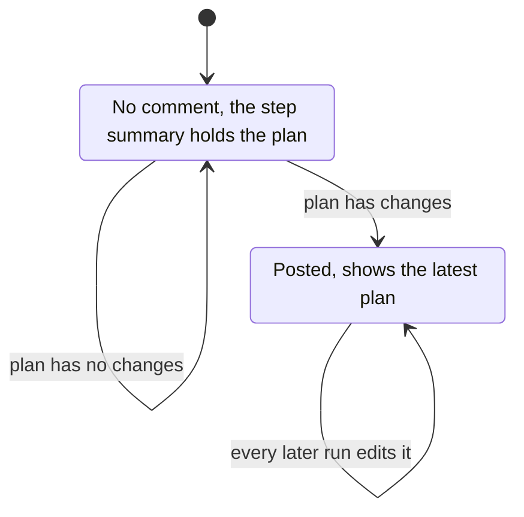

# GitHub Actions

Core's reusable workflows run the CLI. This page explains how a project calls them, what each job does, and which organization settings they read.

## Calling the workflows

A project calls a workflow at `@main` and grants it permissions. It passes no `secrets`, because every credential comes from the vault.

| Workflow        | Trigger in the caller                             | Inputs                                            | Permissions the caller grants                               |
| --------------- | ------------------------------------------------- | ------------------------------------------------- | ----------------------------------------------------------- |
| `deploy.yml`    | A push to the branch that deploys the environment | `environment`, `config_file`, `dev_workflow_file` | `contents: read`, `actions: read`, `id-token: write`        |
| `plan-diff.yml` | A pull request that changes `nextnode.toml`       | `environment`, `config_file`                      | `contents: read`, `pull-requests: write`, `id-token: write` |

`environment` is `development` or `production`. `config_file` is the path of `nextnode.toml` in the repository, the root by default. `dev_workflow_file` names the caller's development workflow, `deploy-dev.yml` by default, and only the production gate reads it.

```yaml
on:
    pull_request:
        paths: ['**/nextnode.toml']

permissions:
    contents: read
    pull-requests: write
    id-token: write

jobs:
    plan-infra:
        uses: NextNodeSolutions/core/.github/workflows/plan-diff.yml@main
        with:
            environment: production
```

`id-token: write` lets core's jobs log in to the vault through GitHub OIDC. [The Infisical vault](../infisical/vault.md#trust-boundary) explains why those jobs run core's code only.

## The deploy workflow



- **plan** validates `nextnode.toml` and writes the quality task matrix and the flags later jobs read. An invalid file stops the run before any other job starts.
- **quality** runs one job per task: the project's `lint` and `test` scripts, the D1 `check_command`, and the production gate. A task fails alone, and the others still report.
- **build** installs the project's dependencies and runs its build. It holds no credential. Its only settings are public ones: the `PUBLIC_SENTRY_DSN` organization Variable, the environment and the commit as the Sentry release. It uploads the directory of `nextnode.toml`, without dependencies, as a short-lived artifact.
- **provision** loads the platform credentials and runs `provision`.
- **migrate** runs `migrate-remote` when the project declares D1 or PlanetScale. It is skipped otherwise, and the deploy still runs.
- **deploy** downloads the build outside the checkout, loads the platform credentials and the repository's secrets, and runs `deploy`.

The credentialed jobs bind to the GitHub environment named by `environment`, so a protection rule set on that environment applies before anything changes.

Runs of the same config file and environment queue behind each other and are never cancelled. Two pushes therefore never race on the Terraform state or a migration.

### The production gate

A production deploy of a project with a development environment adds the gate to the quality tasks. It looks up the run of the caller's development workflow for the same commit and passes only when that run completed successfully. A project with `environment.development = false` has no gate.

## Plan comments

`plan-diff.yml` runs `plan-infra` and keeps one comment per project and environment on the pull request. A hidden marker in the comment finds it again on the next run.



An existing comment is edited even when the plan becomes empty, so it never shows changes that no longer apply. Without a pull request number the plan goes to the step summary only.

## The setup action

Every job starts with core's setup action. It checks out the calling repository and installs pnpm and Node.

- **Infra mode** adds a sparse checkout of core's infrastructure package and lockfile under `.infra/` and installs the package's production dependencies. Jobs that run the CLI use it.
- **Deps mode** installs the calling project's dependencies. It is on by default, so a job that runs the CLI with credentials turns it off.

A quality task that runs a project script works in the caller's clean tree without the core checkout, so a project's lint never scans core's sources.

## Teardown

`teardown.yml` is dispatched by hand from core, so only people with write access to core can run it. It takes the target `repository`, the `environment`, a `confirm` field, `wipe_data` and `config_file`.

1. The job loads the platform credentials and checks out the target's `nextnode.toml` with a token of the NextNode GitHub App.
2. `teardown-guard` stops the run unless `confirm` equals the project's name.
3. `teardown` deletes the Workers, then destroys the Terraform resources, as [Cloudflare Workers](../cloudflare/workers.md#teardown) describes. A project whose backing services hold data needs `wipe_data`.

## Publishing core's packages

`publish-package.yml` releases core's own packages and refuses every other repository. Its quality tasks run first. The publish job then runs only on `main` and only for a package with a `[package]` table.

1. The job loads the npm token and the GitHub App credentials from the vault, builds the package and syncs with the remote `main`.
2. `publish` runs semantic-release in the package directory. When npm accepted the new version but the git push was rejected, it rebases onto `main`, moves the tag and pushes again, a bounded number of times.
3. `publish-result` reads the release output, sets the `status` and `version` step outputs and writes the step summary. It runs even when publishing failed.

## Seeding the vault

`seed-vault.yml` copies the platform credentials from GitHub secrets into the vault once. It exists only for the move described in [Moving off GitHub secrets](../infisical/vault.md#moving-off-github-secrets).

## Organization settings

The workflows read these organization Variables. None is a secret, and none has a default. A command that needs a missing one stops and names it.

| Variable                   | Needed by                                                                    |
| -------------------------- | ---------------------------------------------------------------------------- |
| `INFISICAL_PROJECT_ID`     | Every workflow that loads secrets. It names the vault's CI project.          |
| `INFISICAL_IDENTITY_ID`    | Every workflow that loads secrets. It names the identity the job logs in as. |
| `TF_CLOUD_ORGANIZATION`    | Every command that runs Terraform.                                           |
| `PLANETSCALE_ORGANIZATION` | A project that declares PlanetScale.                                         |
| `COMPANY_DOMAIN`           | A project with an internal Worker. Access admits this email domain.          |
| `ACCESS_SESSION_DURATION`  | A project with an internal Worker. It sets the Access session lifetime.      |
| `PUBLIC_SENTRY_DSN`        | The build job, when the project reports to Sentry.                           |
