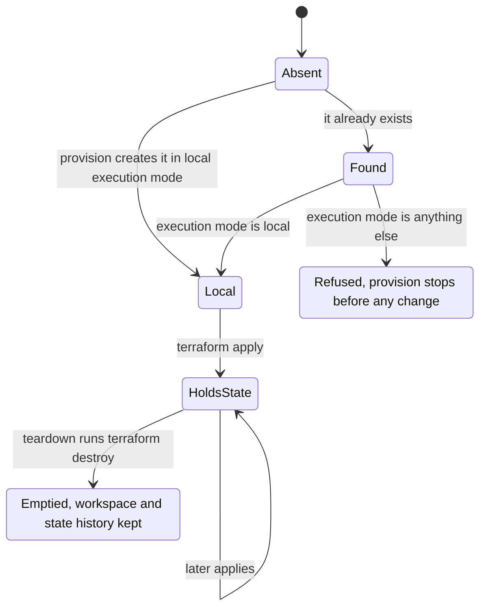
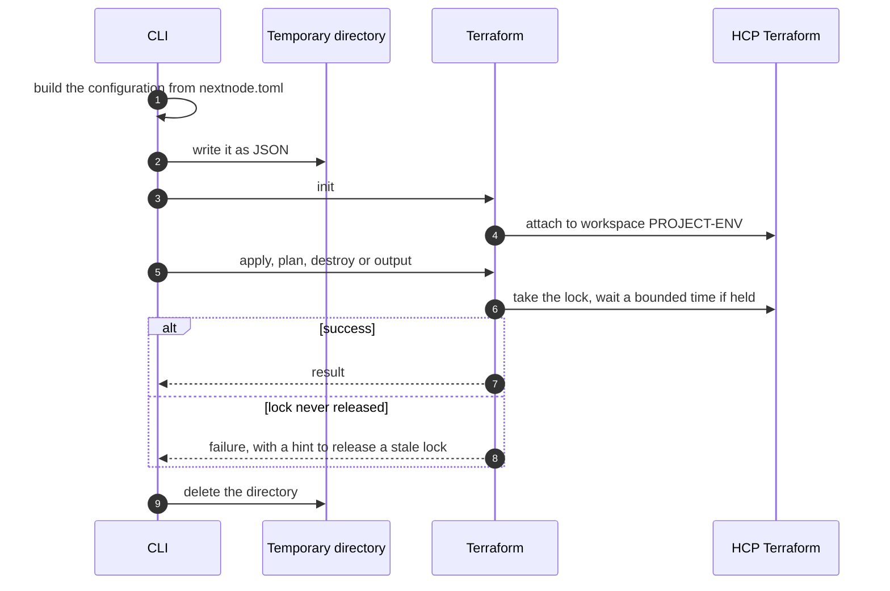

# HCP Terraform

This page explains how the CLI runs Terraform and why HCP Terraform only stores its state.

## Setup

The organization Variable `TF_CLOUD_ORGANIZATION` names the HCP Terraform organization. The CI project of the vault holds `TF_CLOUD_TOKEN`, which the workflows pass to Terraform as `TF_TOKEN_app_terraform_io`. Use a team or user token. An organization token can create workspaces but cannot lock state, and the CLI recognizes that failure and says so.

## The workspace

Each project environment has one workspace, named `PROJECT-ENV`.

Terraform runs inside the CI job, with the credentials the job loaded from the vault. HCP Terraform stores the state and its lock and never runs a plan itself. A workspace in another execution mode would run Terraform on HCP without those credentials, so provision refuses it and names the setting to change. The workspace is created by an API call before Terraform runs, because Terraform needs it as its backend. Teardown keeps it, so the state history stays.

## One Terraform command

No Terraform file is committed anywhere. Every command regenerates the configuration from `nextnode.toml`, so the file is the only source. Provider versions are pinned to a major version inside the CLI. The PlanetScale provider is declared only when the project declares PlanetScale, so other projects never download it.

The account id reaches Terraform as a variable, and only when the configuration holds account-scoped resources. Resource ids flow the other way through Terraform outputs. A deploy reads them once per command, and skips the read when the project declares no backing service and no internal Worker.

`plan-infra` runs a plan with a detailed exit code, which tells "changes pending" apart from "nothing to do" and from a failure. The deploy workflow serializes runs per config file and environment, so two deploys queue instead of competing for the lock.

## Resource identity

Terraform identifies each resource by a label derived from its name in `nextnode.toml`. Renaming a KV namespace, a queue or a bucket in the file changes that label. Terraform then destroys the old resource, with its data, and creates a new one. Review the plan comment on the pull request before merging such a rename.
