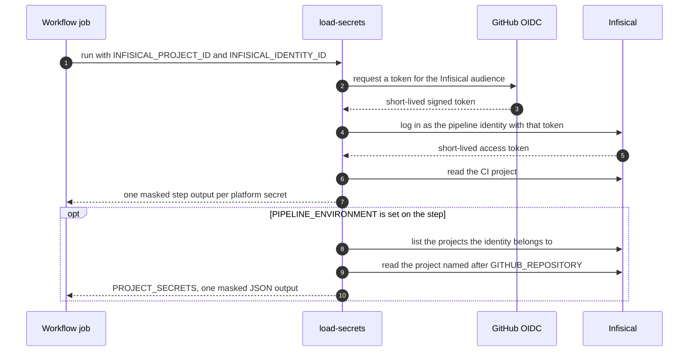
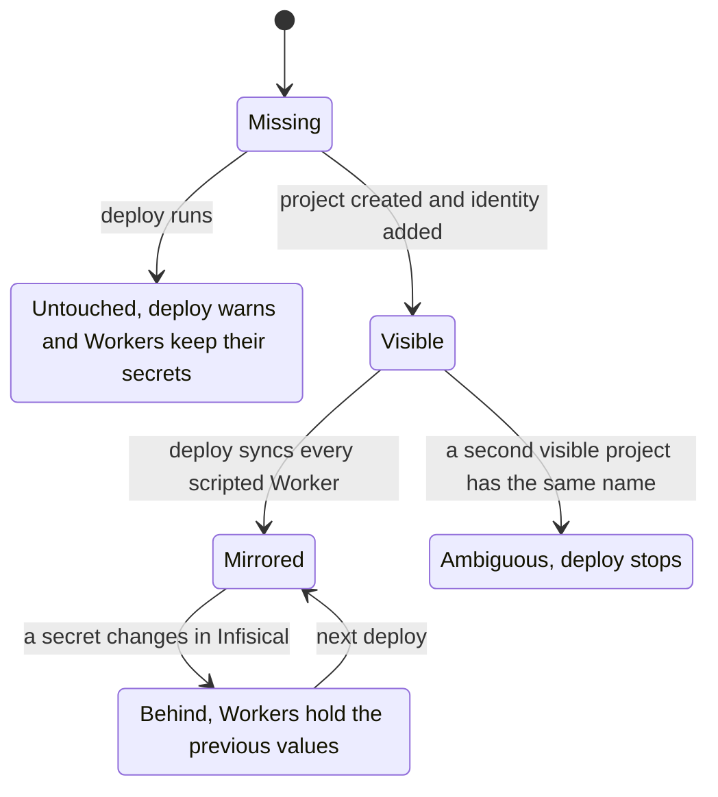

# Infisical vault

Infisical is the only source of secrets for the pipelines and for the Workers they deploy. This page explains how the vault is laid out, how a job reads it, how Worker secrets follow it, and how the vault trusts a job.

Workflows never read `secrets.NAME`, and `nextnode.toml` declares no secret. GitHub Variables stay in GitHub, because they hold settings, not secrets.

## Layout

| Infisical project                                                            | Environments               | Content                                  |
| ---------------------------------------------------------------------------- | -------------------------- | ---------------------------------------- |
| The CI project, whose id is the organization Variable `INFISICAL_PROJECT_ID` | `main`                     | Platform credentials every pipeline uses |
| One project per repository, named exactly like it                            | Development and Production | The secrets of that repository's Workers |

Secrets sit at the root of an environment, with no folder. A development deploy reads the repository project's Development environment and a production deploy reads Production. These are the environments Infisical creates with every project, so a new project needs no renaming. A repository project may pull secrets in through Infisical secret imports. Later imports override earlier ones, and the project's own secrets override every import.

The CI project holds `CLOUDFLARE_API_TOKEN`, `CLOUDFLARE_ACCOUNT_ID`, `TF_CLOUD_TOKEN`, `NEXTNODE_APP_ID`, `NEXTNODE_APP_PRIVATE_KEY`, `NPM_TOKEN`, and for PlanetScale `PLANETSCALE_SERVICE_TOKEN_ID` and `PLANETSCALE_SERVICE_TOKEN`. A workflow reads each one under the same name. `load-secrets` fails when the CI project is empty, so a missing vault setup stops every pipeline at its first step.

## Loading secrets in a job

A job that needs a credential runs `load-secrets` in a step with id `vault`, and later steps read `steps.vault.outputs.NAME`. Each value is masked before it is written, line by line, so a multi-line key stays hidden in the logs. Step outputs reach only the steps that name them, unlike `GITHUB_ENV`, which every later step inherits.

Only the deploy job sets `PIPELINE_ENVIRONMENT` on that step, so only it receives the repository's secrets. Jobs that act on infrastructure alone never see them. The read is live, so a secret changed in Infisical is in the next run.

## A repository's secrets

After a deploy that loaded the project, every Worker with a script holds exactly the project's environment. New secrets are added, changed ones updated, and names the project no longer has are deleted from the Worker. The CLI reads only the names a Worker holds, never the values. A static-assets-only Worker receives no secret, because it runs no code.

A repository without a project still deploys. The run gets a warning annotation that lists the projects the identity can see, and the Workers keep the secrets they hold, so a forgotten membership never wipes a live Worker.

To give a repository secrets:

1. Create an Infisical project with the repository's exact name.
2. Add the identity `github-actions` to it with the built-in role Viewer.
3. Store the secrets in its Development and Production environments.

The project is found by the repository name that the runner sets, not by anything in `nextnode.toml`, so a repository cannot point its pipeline at another repository's project.

Locally, `infisical init` links a checkout to the project, and `infisical run --env=dev -- pnpm dev` replaces `.env.local`. An app types the secrets it reads by augmenting `Cloudflare.Env` in its own declaration file, because type generation knows only bindings and vars.

No secret reaches the build. A value the build needs is not a secret, and it travels as a GitHub Variable into the build job of the deploy workflow.

## Trust boundary

Any step of a job granted `id-token: write` can mint the job's OIDC token, and the vault accepts that token. The identity reads every project it belongs to, so the boundary is what runs in such a job.

- **Such a job runs core's CLI only.** The project's dependencies install and its build runs in the build job, which holds no credential and cannot mint a token. The deploy job ships the uploaded build and never installs the project's dependencies, so the Worker bundle must be self-contained.
- **A PlanetScale migration is the one exception.** It runs the project's own migrate command in the migrate job, as [PlanetScale](../planetscale/database.md) describes.
- **The build artifact lands outside the checkout.** A project's artifact therefore cannot replace core's CLI before the deploy job runs it.
- **The publish workflow refuses other repositories.** Its publish job runs a package's release tooling, which is caller code by construction, so it runs only for core, whose code and lockfile are the trusted base.

The identity trusts the `job_workflow_ref` claim. Only core's workflow files on `main` can log in, whichever repository calls them. In a called workflow the claim names the called file. In a workflow run directly, such as Seed Vault or teardown, it names that workflow's own file. The `repository_owner_id` claim pins the organization by its immutable id. This trust is exactly as strong as the protection of core's `main`, which accepts pull requests only.

## Vault setup

The vault is set up once. It holds the CI project with its environment `main`, and one organization identity, `github-actions`, with the organization role No Access. The identity is a member of the CI project with the built-in role Member, and of each repository's project with the built-in role Viewer. Its id is the organization Variable `INFISICAL_IDENTITY_ID`. Its OIDC Auth settings:

| Field                        | Value                                                        |
| ---------------------------- | ------------------------------------------------------------ |
| OIDC Discovery URL           | `https://token.actions.githubusercontent.com`                |
| Issuer                       | `https://token.actions.githubusercontent.com`                |
| Subject                      | `repo:NextNodeSolutions*`                                    |
| Audiences                    | `https://app.infisical.com`                                  |
| Claim `repository_owner_id`  | `259621712`                                                  |
| Claim `job_workflow_ref`     | `NextNodeSolutions/core/.github/workflows/*@refs/heads/main` |
| Access token TTL and max TTL | `900`                                                        |

The audience must match the one the CLI requests when it asks GitHub for a token. Infisical matches the Subject as one glob, with no comma list. Newer repositories carry GitHub's immutable subject form, `repo:NextNodeSolutions@259621712/REPO@ID:…`, and cannot opt out, so the glob covers both forms. The Subject is not the trust boundary. `repository_owner_id` pins the organization and `job_workflow_ref` pins core's workflows. Each claim accepts a comma-separated list. A claim mapped through Claim Mapping must be present in every token, or Infisical refuses the login.

## Moving off GitHub secrets

The Seed Vault workflow and its `seed-platform-secrets` command exist only for this move. They are deleted once the GitHub secrets are gone.

1. Set up the vault and the two Infisical organization Variables before merging the vault change. Without them, every pipeline fails at `load-secrets`.
2. Run the Seed Vault workflow in core once. It copies the platform credentials from GitHub into the CI project and never overwrites a secret the vault already holds. Storing the platform credentials listed in [Layout](#layout) by hand replaces the run.
3. Create each repository's project and store its secrets there by hand. Seed Vault does not copy repository or environment secrets.
4. Delete the GitHub secrets, then the Seed Vault workflow and its command, and lower the identity to Viewer on the CI project. Callers switch to the deploy workflow, drop their `secrets: inherit` line and remove `secrets` from their `nextnode.toml`.
