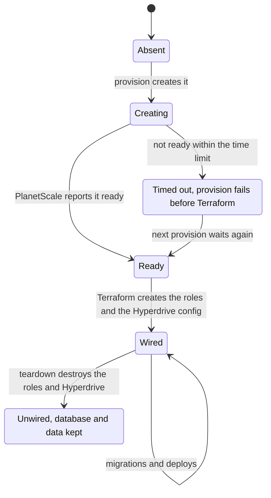
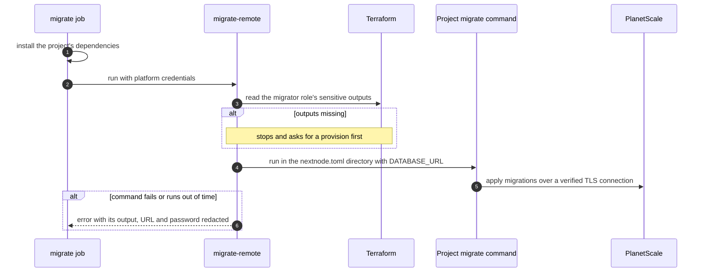

# PlanetScale

A project can declare one PlanetScale Postgres database with `[services.planetscale]`. This page explains how the CLI creates it, how Workers reach it, and how migrations run.

## Setup

The organization Variable `PLANETSCALE_ORGANIZATION` names the PlanetScale organization. The CI project of the vault holds `PLANETSCALE_SERVICE_TOKEN_ID` and `PLANETSCALE_SERVICE_TOKEN`. The CLI uses that service token for its own API calls, and the PlanetScale Terraform provider reads it from the environment.

## The database

The PlanetScale Terraform provider manages roles but has no database resource. Provision therefore creates the database through the PlanetScale API when it is missing, waits until it is ready, and only then runs Terraform. `cluster_size` and `region` apply when the database is created. An existing database keeps its size and region.

Each project environment gets its own database, named after the project and the environment. Teardown never deletes it, because the data cannot come back. Delete it by hand in PlanetScale when the project is gone for good.

## Roles and Hyperdrive

Terraform creates two roles on the database's default branch:

- a runtime role that reads and writes data but cannot change the schema, used by Hyperdrive;
- a migrator role with full rights, used only by migrations.

A Hyperdrive configuration pools connections to the runtime role. Its credentials live in Terraform state only. A Worker with `needs = ["planetscale"]` gets a Hyperdrive binding and connects through the binding's connection string. No database URL or password reaches a Worker's env.

## Migrations

`migrate_command` sets the command, and a Drizzle Kit migration is the default. Only that subprocess receives `DATABASE_URL`. It runs within a time limit, and its output is truncated and stripped of the URL and password before it reaches an error.

This is the only place where the project's own code runs in a job that can read the vault. The migrate job installs the project's dependencies only when the project declares PlanetScale. [The Infisical vault](../infisical/vault.md#trust-boundary) explains why every other credentialed job runs core's CLI alone.
