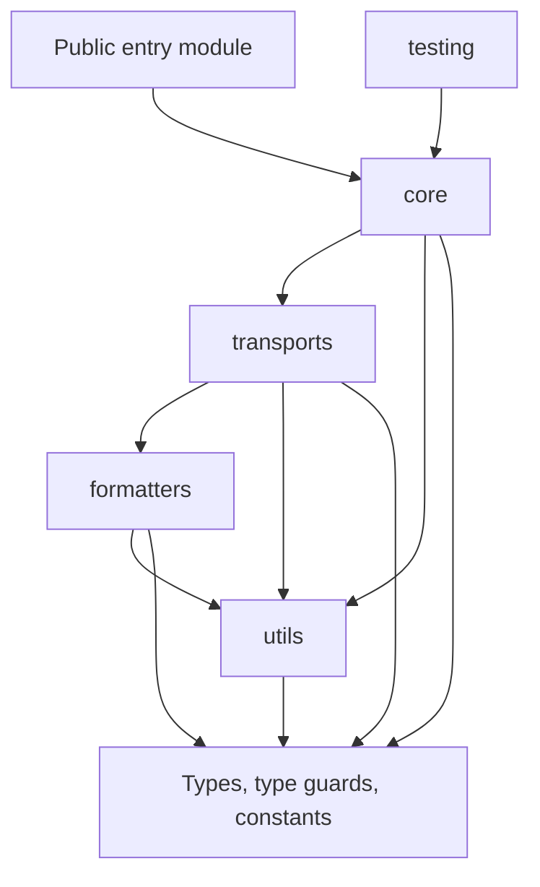

# AGENTS.md

This scope is `@nextnode-solutions/logger`, the structured logger that NextNode packages and apps import. Its rules add to the [root AGENTS.md](../../AGENTS.md). Usage and the main flow are in [README.md](README.md), and the parts and their contracts are in [the architecture guide](docs/architecture.md).

## Invariants

- **Add no runtime dependency.** The manifest holds only `devDependencies`, and its description promises a zero-dependency library. Consumers bundle the logger into browser and worker code, where every dependency would ship too. Write the helper in `utils` instead.
- **Keep shipped code free of Node built-ins.** One bundle runs in Node, browsers and web workers, so a single `node:` import breaks every browser consumer. Use globals every runtime has, such as `console`, `crypto.randomUUID`, `fetch`, `AbortController`, `URL` and timers. Specs and config files may use Node, because they never ship.
- **Read runtime-specific globals such as `process`, `window`, `document` and `importScripts` only inside environment detection, behind a `typeof` check.** A bare reference throws a `ReferenceError` in a runtime that lacks the global. Every other module asks environment detection or receives the value as an option.
- **Feature-detect a runtime-specific method before calling it.** The HTTP transport checks that its timer has `unref` before calling it, because browser timers are plain numbers.
- **Never let a log call throw into the caller.** Catch, fall back and report, as the stack parser does when it returns an unknown location. Logging is a side channel, and a crash there takes the application down with it.
- **Never call a logger from inside the package.** Report internal failures with `console.warn` or `console.error` behind a `[logger]` prefix, or embed the failure in the output, as `safeStringify` does. A logger that logs its own failure recurses through the path that just failed.
- **Generate the request id once per logger instance.** Per-call ids would give the lines of one request different ids and break tracing. Children inherit the id, and a log object can override it for one entry.

## Layers



The public entry module also re-exports from every layer. The HTTP transport is a build entry point of its own.

- **Put the logger class, its factory and the entry builder in `core`.** `core` filters and dispatches, and it never formats or prints an entry.
- **Put every console call and every network call in `transports`.** A transport only sees `LogEntry` values. Never import `core` from a transport, because `core` imports the console transport for its default and the reverse import would make a cycle.
- **Keep `formatters` free of side effects and globals.** Every console formatter ships in every bundle and must load in any runtime. A console call that only makes sense in DevTools, such as a collapsed group, belongs in the console transport's writer for that format.
- **Choose the output format only in the console transport.** The logger stays format-agnostic, so a custom transport list keeps working.
- **Keep `utils` free of imports from `core`, `transports` and `formatters`.** Every layer imports `utils`, so an upward import makes a cycle.
- **Keep the types module free of runtime code.** Put type guards in the type-guards module and shared constants in the constants module, so the contract every layer imports stays declarations only.
- **Keep a constant in the module that uses it, unless several directories or consumers need it.** Then it moves to the constants module, or to the formatters' shared module when only formatters share it. Each value keeps one owner.
- **Declare a config or output type beside the module it belongs to.** `HttpTransportConfig` lives with the HTTP transport. Types shared across layers or used by consumers go in the types module.
- **Re-export public names only from the public entry module.** The `nextnode/no-barrel-file` lint rule rejects every other barrel. The public entry module and the type re-export of the testing entry carry an explicit opt-out.

## Conventions and traps

- **Pair every stateful class with a `create<Name>` factory in the same module.** `ConsoleTransport` and `createConsoleTransport` follow it. Consumers pick either form, and the docs show the factory.
- **Import with relative paths that end in `.js` inside the source, and through the `@/` alias in specs.** The build emits ES modules, and `verbatimModuleSyntax` requires `import type` for type-only imports.
- **Open every source module with a doc comment that states its responsibility.** It is the first thing a reader of the layer sees.
- **Type every per-level map as `Record<LogLevel, …>`, and update `isLogLevel` by hand when the levels change.** The `Record` type makes the compiler flag every map that misses a level. The guard checks a literal list the compiler does not compare with `LogLevel`.
- **Review every new global by hand.** The TypeScript config loads the DOM, WebWorker and Node types together, so a global that exists in only one runtime still type-checks.
- **Pass the level method the caller invoked to the entry builder as its entry point.** The stack parser cuts the stack at that function, so the location is the caller's code whatever the bundler did to the logger's files. Helpers on the call path need nothing more, but a new public method that logs must pass itself.
- **Catch every rejection inside a transport that returns a promise.** The logger does not await `log`, so a rejection escapes as an unhandled rejection. Report delivery failures through a callback in the transport's config, like `onError` on the HTTP transport, and catch what that callback throws, because it is caller code.
- **Give a console transport the environment explicitly.** It never reads `NODE_ENV`. Only the logger does, and it passes its environment to the console transport it creates by default.
- **Add optional keys with a conditional spread, and declare `| undefined` on optional fields that receive pass-through values and on every optional property of a public type.** The shared TypeScript config enables `exactOptionalPropertyTypes`, which rejects `undefined` assigned to a plain optional key, so a consumer with that flag could not pass a value that may be undefined. Resolve each option with `??`, because a spread lets an explicit undefined replace a default.
- **Validate configuration in the constructor and throw a plain `Error` that names the bad value.** A misconfiguration then fails at startup, not on the first log line.
- **Put a `// Business rule:` comment on every catch that swallows an error, saying why.** Swallowing is deliberate here, and the comment stops a later change from "fixing" it.
- **Build every entry a test double records with the shared entry builder.** Consumers' tests then see the production entry shape.
- **Keep the testing entry free of Vitest and Jest at runtime.** Consumers run their tests under any runner, so the mock logger implements its own mock functions.

## Tests

- **Mirror the source directories in `__tests__`, with one `<module>.spec.ts` per module.** A spec is then found from the module's path.
- **Mock the console in every spec that logs, with the console helpers of the shared test setup module.** Specs never print, and assertions read the mocks.
- **Simulate a runtime by stubbing its globals with `vi.stubGlobal`.** Specs run in the Node environment of the shared Vitest preset, so globals such as `process`, `window`, `document`, `importScripts` and `crypto` are stubbed to exercise each runtime branch. The shared Vitest preset restores stubs and mocks after each test.
- **Stub `fetch` and use fake timers for the HTTP transport.** Specs never reach a real collector.
- **Reset a formatter's scope color cache before each spec that checks colors.** The color of a scope depends on the order of first use.

## Extending

### A transport

1. Add a module to `transports` with a `<Name>TransportConfig` type, a `<Name>Transport` class that implements `Transport`, and a `create<Name>Transport` factory.
2. Validate the configuration in the constructor.
3. Keep `log` synchronous and cheap. Buffer or queue the IO, and implement `dispose` when the transport holds a timer, a buffer or a connection.
4. Render entries with a formatter, or add one with the next recipe.
5. Expose it from the public entry module, or as its own subpath entry point when consumers should opt into it, as the HTTP transport does.
6. Add a spec in the matching `__tests__` directory, and describe the transport in the docs.

### A console output format

1. Add a formatter module to `formatters`. Reuse the formatters' shared module for icons and location display, and the scope color cache for scope colors.
2. Export a cache reset for specs when the formatter keeps a cache, as the console formatters do. Do not re-export it publicly.
3. Add the format name to the console format union and register its writer in the writer registry. The registry's `Record` type refuses to compile until the writer exists.
4. Change the console transport's format resolution only when the new format must be chosen automatically.

### A field on entries or log objects, or a logger option

1. Add it to `LogEntry`, `LogObject`, `LoggerConfig` or `ChildLoggerConfig` in the types module.
2. Fill a field in the entry builder. A key that moves from the log object onto the entry, as `scope` and `requestId` do, is split off by the scope splitter in `utils`.
3. Resolve an option's default in the logger constructor and pass it on in `child`.
4. Render a new field in every formatter, and extend `JsonLogOutput` when the JSON shape changes.
5. Mirror an option in the spy logger when it changes what the spy records.

### A log level

1. Add it to `LogLevel` and fix every compile error from the per-level maps.
2. Update `isLogLevel` by hand.
3. Add the method to the `Logger` interface, the logger class and every test double.

### A public export or an entry point

1. Add a named re-export to the public entry module, with `export type` for types.
2. For a new subpath, add the module to the build entries in the tsdown config and the matching `types` and `import` paths to `exports` in `package.json`. The build entry key decides the output file name, so keep both in sync.
3. Run the build and check that the output holds the new JavaScript and declaration files.

## Verification

Run these from the repository root. Each must pass.

```sh
pnpm --filter @nextnode-solutions/logger type-check
pnpm --filter @nextnode-solutions/logger lint
pnpm --filter @nextnode-solutions/logger test
```

Also run `pnpm --filter @nextnode-solutions/logger build` when a change touches an entry point, the build config or `exports`. Run `pnpm --filter @nextnode-solutions/logger format:check` after editing Markdown, because the formatter covers it.
