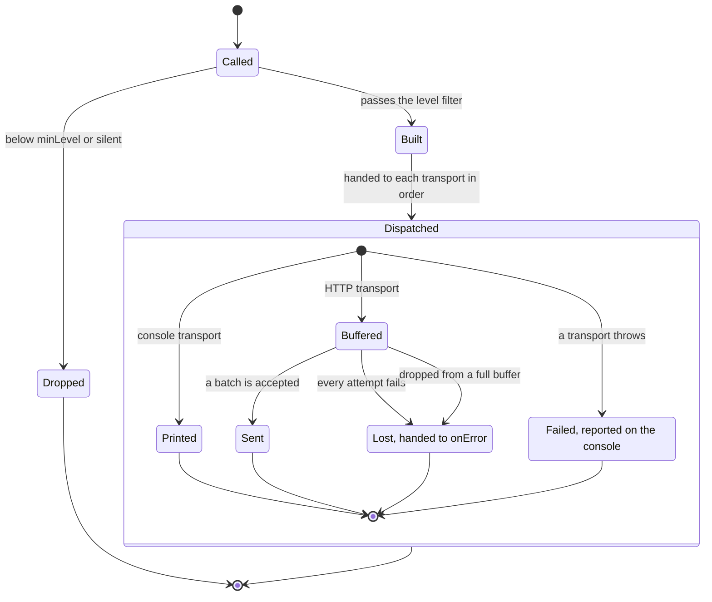

# @nextnode-solutions/logger

A structured logger for NextNode projects that runs unchanged in Node, in browsers and in web workers, with no runtime dependencies. Every service writes the same entry shape, so one request can be followed across them. Entries print as readable colored lines in development, as one JSON object per line in production, and go to any destination a transport implements.

## Quick start

```sh
pnpm add @nextnode-solutions/logger
```

```ts
import { createLogger, generateRequestId } from '@nextnode-solutions/logger'

const logger = createLogger({ scope: 'api' })

logger.info('Server started', { details: { port: 3000 } })

export const handle = (request: Request): Response => {
	const log = logger.child({
		scope: 'orders',
		requestId: request.headers.get('x-request-id') ?? generateRequestId(),
	})

	log.info('Order received', { details: { url: request.url } })
	log.error('Payment failed', {
		status: 502,
		details: { provider: 'stripe' },
	})

	return new Response('accepted', { status: 202 })
}
```

Each import path is a separate entry point:

| Import path                                  | Provides                                                                                 |
| -------------------------------------------- | ---------------------------------------------------------------------------------------- |
| `@nextnode-solutions/logger`                 | `createLogger`, the console transport, formatters, public types, type guards and helpers |
| `@nextnode-solutions/logger/testing`         | Spy, mock and no-op loggers for tests                                                    |
| `@nextnode-solutions/logger/transports/http` | The batching HTTP transport                                                              |

## How it works



1. `createLogger` resolves the environment from the `environment` option or `NODE_ENV`, generates one request id for the instance, and sets up its transports. Without a `transports` option it uses one console transport.
2. A level method drops the entry when the logger is silent or the level is below `minLevel`.
3. The logger builds a `LogEntry`. It holds the message with its prefix, a timestamp, the caller's location, the scope, the request id and the rest of the log object.
4. The logger hands the entry to each transport in order. A transport that throws is reported on the console, and the next one still runs.
5. The console transport prints JSON in production, ANSI-colored text in Node and styled, expandable output in browser DevTools.
6. The HTTP transport buffers entries up to a limit and posts them to a collector in batches. A full buffer drops its oldest entries while a batch is in flight.

The parts, the contracts between them and what each failure leaves behind are in [the architecture guide](docs/architecture.md). Every option, and how the environment is detected, is in [the configuration guide](docs/configuration.md). The HTTP transport has [its own page](docs/transports/http.md). [Testing code that logs](docs/test-doubles.md) covers the spy, mock and no-op loggers.

## Contributing and releases

The rules for changing this package, and the commands that verify a change, are in [AGENTS.md](AGENTS.md). Rules shared by every package are in the [root AGENTS.md](../../AGENTS.md). semantic-release versions the package and publishes it to npm, as the [root README](../../README.md) describes.
