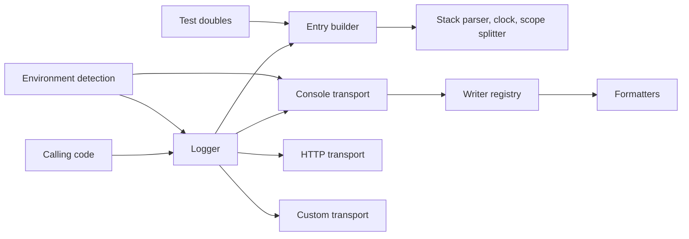
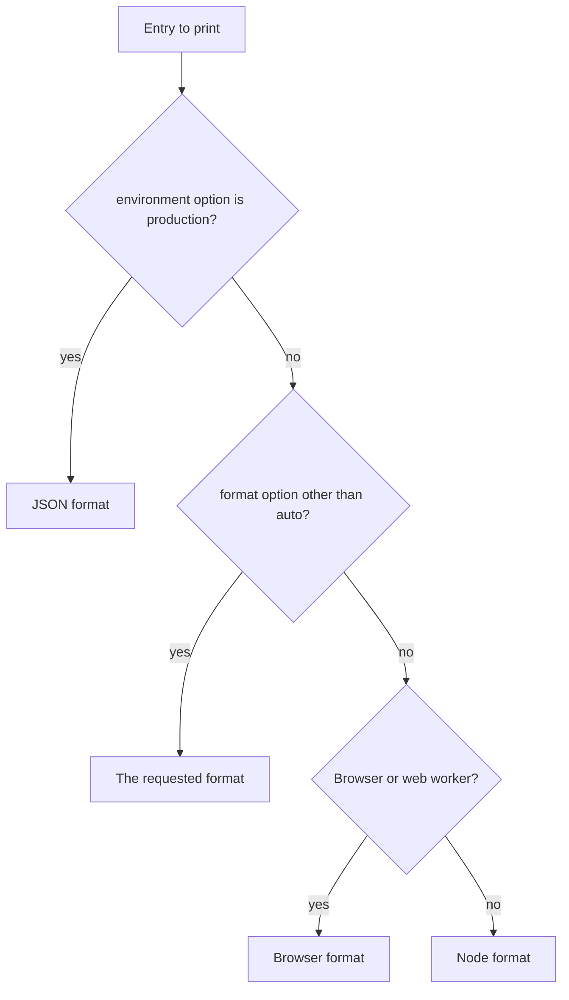
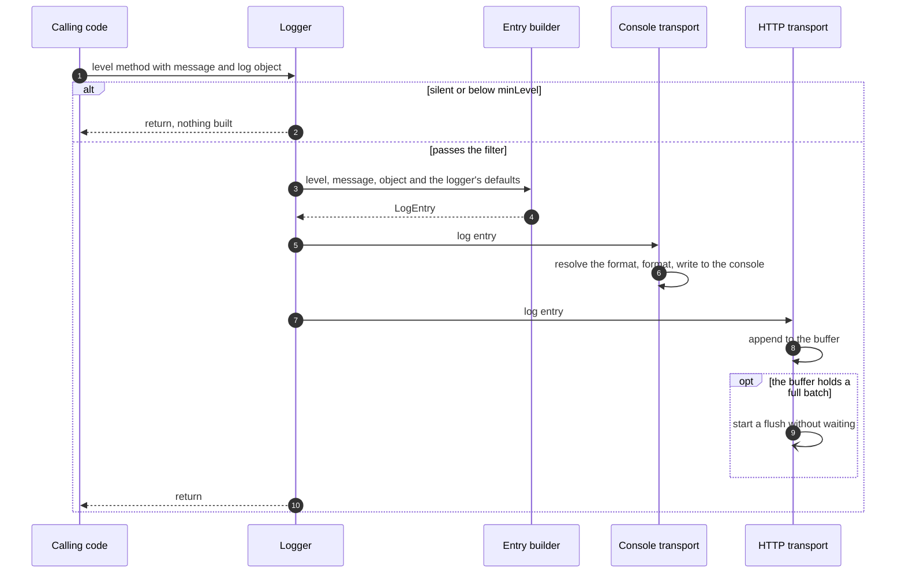
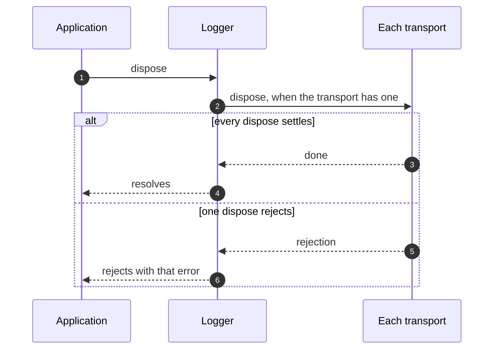

# Architecture

This page explains how a log call becomes output. It covers the parts of the logger, the contract at each boundary, the flow of each operation, what a failure leaves behind, and the guarantees the package keeps.

## Parts



- The logger is a `NextNodeLogger`, made by `createLogger`. It holds the resolved options, filters entries by level and hands each entry to its transports.
- The entry builder turns one call into one `LogEntry`. The logger and the spy logger share it, so tests record exactly what production would send.
- Environment detection decides between development and production, and between Node, browser and web worker. It is the only part that reads runtime-specific globals.
- Transports deliver entries. The console transport picks a format for each entry and calls the writer registered for it. The HTTP transport batches entries for a remote collector.
- Formatters turn a `LogEntry` into output. They are plain functions with no side effects, so every console formatter ships in every bundle and load in any runtime.
- Test doubles implement `Logger` for the tests of consuming code. [Testing code that logs](test-doubles.md) describes them.

## Boundaries

### Calling code and the logger

A `Logger` has one method per level and a `child` method. Each level method takes a message and an optional `LogObject`. Once a logger exists, a log call never throws.

The log object splits in two on its way into the entry. `scope` and `requestId` are lifted onto the entry and win over the logger's own values for that one entry. `details`, `status` and every other key stay together as the entry's `object`. The logger's `prefix` is put in front of the message, separated by a space.

`child()` returns a new logger that shares the parent's transports. It inherits the environment, the location setting, silence, the prefix, the minimum level and the request id. It can override the scope, the prefix, the minimum level and the request id.

### The logger and its transports

A transport is any object that implements `Transport`:

- The logger calls `log(entry)` once per entry, synchronously, in the order of the `transports` list.
- The logger does not await what `log` returns. A transport that returns a promise must handle its own rejections.
- When `log` throws, the logger reports the error with `console.error` and calls the next transport.
- `dispose()` is optional. `logger.dispose()` calls it on every transport that has one and waits for all of them. Children share their parent's transports, so disposing a child disposes the parent's transports too.

```ts
import {
	createConsoleTransport,
	createLogger,
	formatAsJson,
} from '@nextnode-solutions/logger'

import type { LogEntry, Transport } from '@nextnode-solutions/logger'

class MemoryTransport implements Transport {
	readonly lines: string[] = []

	log(entry: LogEntry): void {
		this.lines.push(formatAsJson(entry))
	}
}

const memory = new MemoryTransport()

const logger = createLogger({
	transports: [createConsoleTransport({ format: 'json' }), memory],
})

logger.info('Stored and printed')
```

A `transports` option replaces the default console transport. Put a console transport in the list to keep console output.

### The console transport and the formatters



The console transport knows the environment only through its own `environment` option. The logger passes its environment to the console transport it creates by default. A console transport you create without that option never switches to JSON on its own. In production, the `format` option is ignored and the output is always JSON. The runtime is detected once, when the transport is created, and any runtime that is neither a browser nor a web worker gets the Node format.

Each level maps to a console method, and each format has a writer that calls its formatter and then the console. The `writers` option replaces the writer of one format, for example to send that output somewhere other than the console.

- The Node formatter returns one ANSI-colored line, then one indented line per key of the entry's object. It serializes values with `safeStringify`, which survives circular references.
- The browser formatter returns a `%c` format string, the CSS for each part and the objects to inspect. Its writer prints an entry that carries an object as a collapsed group, so DevTools can expand the object.
- The JSON formatter returns one line. It flattens the keys of the entry's object onto the top level, so a log store can query them. It skips undefined values and keys that could pollute an object prototype. A `bigint` becomes its decimal string, and a circular reference becomes the marker the Node formatter prints. The HTTP transport serializes its request body with the same rules.
- The console formatters color the scope from a bounded cache, so a scope keeps its color while the cache holds it.

### Caller location

Every entry records the function that called the logger. With `includeLocation`, it also records the file name and the line. The logger reads both from `new Error().stack` on every call, even when only the function name is kept. It skips frames from `node_modules` and from its own source files. A call made from one of your files that has the same name as one of the logger's files is skipped as well, and the location then points to the next frame.

## Operations

### A log call



### Shutdown



## What a failure leaves behind

| Failure                                                                      | What is left                                                                                                                                                                                        |
| ---------------------------------------------------------------------------- | --------------------------------------------------------------------------------------------------------------------------------------------------------------------------------------------------- |
| A transport throws in `log`                                                  | A `console.error` line. The other transports still received the entry. The caller saw nothing.                                                                                                      |
| A transport's `log` promise rejects                                          | An unhandled rejection. The logger never sees it.                                                                                                                                                   |
| The stack cannot be parsed                                                   | An entry whose location is `unknown`, and a `console.warn` line that says why.                                                                                                                      |
| A value in the object cannot be serialized by the Node formatter             | A placeholder that names the error, in place of the value. Circular references become a marker.                                                                                                     |
| A value in the object is a `bigint` or holds a cycle                         | Nothing is lost. JSON output writes the `bigint` as its decimal string and the circular reference as a marker.                                                                                      |
| A getter or a `toJSON` method in the object throws during JSON serialization | No JSON line for that entry. The console transport throws, and the logger reports it as a failed transport. The HTTP transport hands that entry alone to `onError` and sends the rest of its batch. |
| Web Crypto is missing and no `requestId` option was given                    | No logger. `generateRequestId` throws from the constructor.                                                                                                                                         |
| A transport's configuration is invalid                                       | No transport. Its constructor throws.                                                                                                                                                               |
| Every HTTP attempt for a batch fails                                         | The batch is gone from the buffer, and `onError` receives it with the error.                                                                                                                        |

## Guarantees

1. **No runtime dependencies.** Consumers bundle the logger into browser and worker code, where every dependency would ship too.
2. **One bundle runs in Node, browsers and web workers.** Runtime-specific globals are read only behind `typeof` checks, inside environment detection, and the formatters use no globals at all.
3. **A log call never throws into the caller.** Logging is a side channel, so a broken stack, an odd value or a failing transport must not break the code that logs.
4. **The request id is fixed per logger instance.** Every entry from one logger and its children carries the same id unless a call overrides it, so one request can be traced.
5. **The logger never logs through itself.** Its own failures go straight to `console.warn` or `console.error`, so a failure cannot recurse through the path that failed.
6. **The spy logger records the production entry shape.** It uses the same entry builder as the logger.
