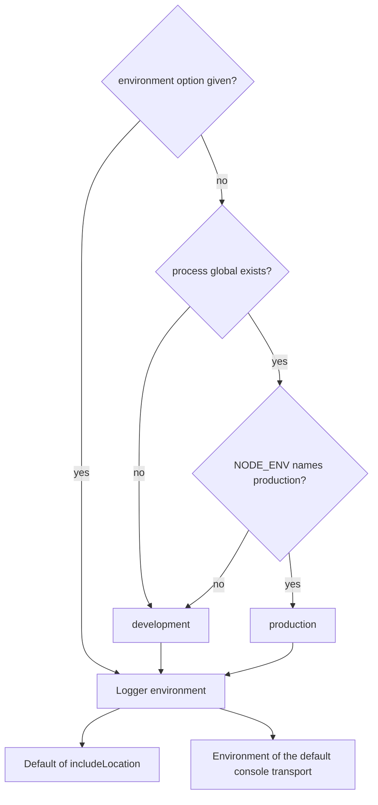

# Configuration

This page explains where the logger's options come from and what each one does. The logger reads one environment variable, `NODE_ENV`. Everything else is passed in code.

## Where the environment comes from



`detectEnvironment` decides which `NODE_ENV` values count as production. Any other value, an unset variable included, gives development, because development output is the more verbose one. A browser has no `process` global, so detection there always gives development. Pass `environment: 'production'` explicitly in browser production builds.

The environment sets the default of `includeLocation`, which is on in development and off in production. It also decides whether the default console transport prints JSON.

## Logger options

`createLogger` takes a `LoggerConfig`. Every option is optional.

| Option            | Effect                                                                                                           |
| ----------------- | ---------------------------------------------------------------------------------------------------------------- |
| `environment`     | Overrides `NODE_ENV` detection.                                                                                  |
| `minLevel`        | Drops every entry below this level. Levels are ordered by `LOG_LEVEL_PRIORITY`. Without it, every level is kept. |
| `silent`          | Drops every entry. Useful for a library that logs only when its caller injects a logger.                         |
| `scope`           | Labels every entry. A `scope` key in a log object wins for that one entry.                                       |
| `prefix`          | Is put in front of every message.                                                                                |
| `requestId`       | Replaces the request id the logger would generate. A `requestId` key in a log object wins for that one entry.    |
| `includeLocation` | Adds the file name and line to each entry's location. The calling function is always recorded.                   |
| `transports`      | Replaces the default console transport with this list.                                                           |

`child()` takes a `ChildLoggerConfig`, which accepts `scope`, `prefix`, `minLevel` and `requestId`. The child inherits every other setting from its parent and shares its transports.

```ts
import { createLogger } from '@nextnode-solutions/logger'

const logger = createLogger({
	scope: 'billing',
	prefix: '[eu]',
	minLevel: 'info',
	includeLocation: true,
})

const invoices = logger.child({ scope: 'invoices', minLevel: 'warn' })

invoices.warn('Invoice overdue', { details: { invoiceId: 'inv_42' } })
```

## Console transport options

`createConsoleTransport` and `new ConsoleTransport` take a `ConsoleTransportConfig`.

| Option        | Effect                                                                                                              |
| ------------- | ------------------------------------------------------------------------------------------------------------------- |
| `environment` | With `production`, every entry prints as JSON and `format` is ignored. The transport never reads `NODE_ENV` itself. |
| `format`      | Forces `json`, `node` or `browser` output. `auto` picks from the runtime.                                           |
| `writers`     | Replaces the writer of one or more formats, for example to send output somewhere other than the console.            |

When you pass your own `transports`, give the console transport the environment, or set `format: 'json'`. Otherwise production output stays human-readable.

```ts
import {
	createConsoleTransport,
	createLogger,
	detectEnvironment,
} from '@nextnode-solutions/logger'

const environment = detectEnvironment()

const logger = createLogger({
	environment,
	transports: [createConsoleTransport({ environment })],
})

logger.info('Same output as the default transport')
```

The HTTP transport's options are on [its own page](transports/http.md).

## How mistakes are reported

The types catch most mistakes, such as an unknown level name. Values that arrive at runtime, such as an environment variable, are not validated by the logger. Check them with the exported type guards first.

```ts
import { createLogger, isLogLevel } from '@nextnode-solutions/logger'

const requested = process.env.LOG_LEVEL

const logger = createLogger(
	isLogLevel(requested) ? { minLevel: requested } : {},
)

logger.info('Configured')
```

Creating a logger without a `requestId` option throws when the runtime has no Web Crypto `crypto.randomUUID`. The HTTP transport validates its configuration in its constructor and throws an `Error` that names the bad value.
