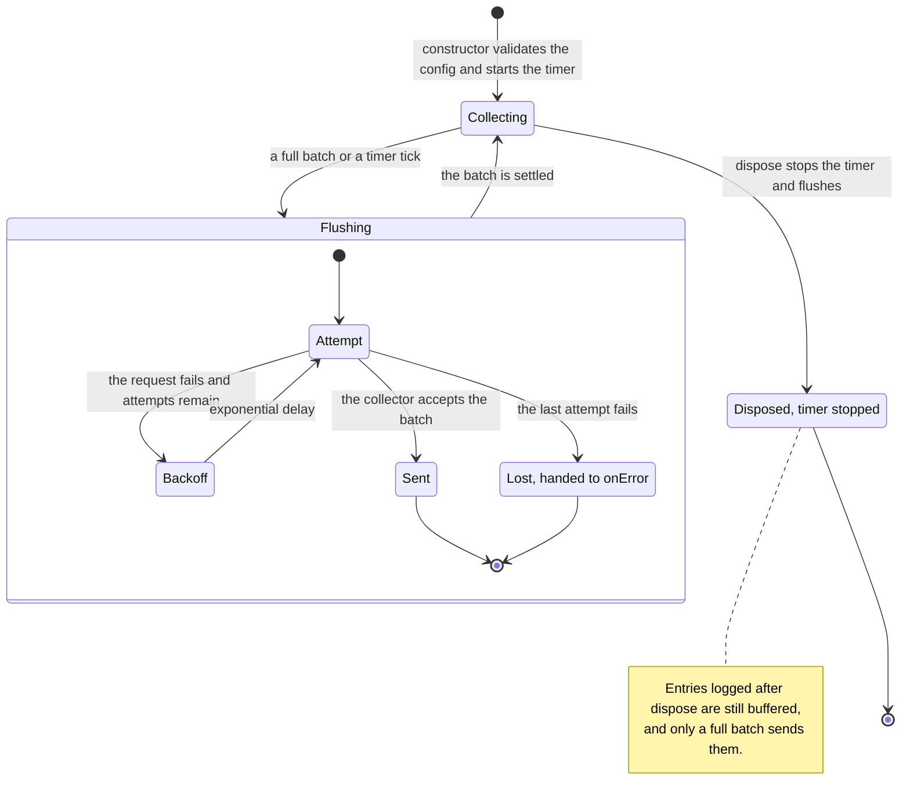
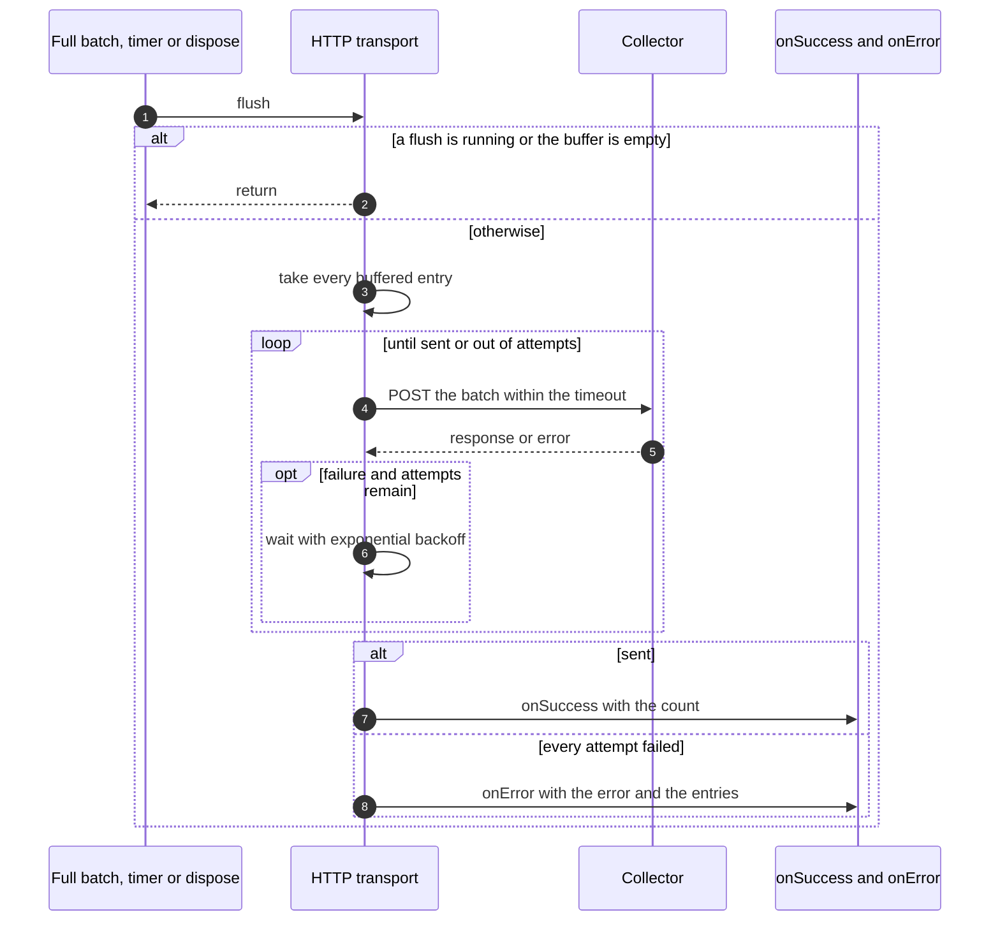

# HTTP transport

The HTTP transport sends log entries to a remote collector in batches. It lives at its own import path, `@nextnode-solutions/logger/transports/http`, and the main entry point does not export it.

## Setup

```ts
import {
	createConsoleTransport,
	createLogger,
} from '@nextnode-solutions/logger'
import { createHttpTransport } from '@nextnode-solutions/logger/transports/http'

const http = createHttpTransport({
	endpoint: 'https://logs.example.com/ingest',
	headers: { Authorization: 'Bearer TOKEN' },
	onError: (error, entries) => {
		console.error(`Dropped ${entries.length} log entries: ${error.message}`)
	},
})

const logger = createLogger({
	environment: 'production',
	transports: [createConsoleTransport({ environment: 'production' }), http],
})

logger.info('Shipped to the collector')

// Before the process exits, stop the timer and send what is still buffered.
await logger.dispose()
```

`createHttpTransport` and `new HttpTransport` take an `HttpTransportConfig`. Only `endpoint` is required. The defaults of the other options are documented on `HttpTransportConfig`.

| Option          | Effect                                                                |
| --------------- | --------------------------------------------------------------------- |
| `endpoint`      | The URL every batch is posted to.                                     |
| `headers`       | Extra request headers, such as an authorization token.                |
| `batchSize`     | A full batch of this many entries is sent at once.                    |
| `flushInterval` | The buffer is also sent on a timer with this period.                  |
| `timeout`       | Each request is aborted after this time.                              |
| `maxRetries`    | The total number of attempts per batch, the first one included.       |
| `onError`       | Receives the error and the entries of a batch that could not be sent. |
| `onSuccess`     | Receives the number of entries in a batch that was sent.              |

## What crosses the boundary

- Each batch is one `POST` to `endpoint`, with a JSON content type and the configured `headers`.
- The body is a JSON object whose `logs` array holds the raw `LogEntry` objects. It is not the flattened JSON line the console prints.
- A response outside the success range counts as a failure, like a network error or a timeout.
- The endpoint must be an `http` or `https` URL. The constructor refuses any other protocol, so a mistyped URL cannot reach a non-HTTP scheme.
- The constructor refuses headers that the HTTP layer manages, such as `Host`, so configuration cannot inject them.

## Lifecycle



`log` only appends to the buffer, so a log call never waits for the network. A flush takes every buffered entry at once. Entries logged during a flush wait for the next one, and a flush requested while another runs is skipped. The buffer has no size limit, so a slow collector makes it grow.

The timer does not keep a Node process alive. A process that exits without `dispose` therefore ends on time, but it loses the entries still in the buffer.

## A flush



## Failures

| Failure                                 | What is left                                                                                                                                                         |
| --------------------------------------- | -------------------------------------------------------------------------------------------------------------------------------------------------------------------- |
| Invalid endpoint or managed header      | No transport. The constructor throws an `Error` that names the value.                                                                                                |
| Network error, failed status or timeout | A retry after an exponential delay, until attempts run out.                                                                                                          |
| Every attempt fails                     | The batch is gone from the buffer. `onError` receives it with the last error. Without `onError`, nothing reports the loss.                                           |
| `onSuccess` throws                      | `onError` receives that error with the entries, although they were sent.                                                                                             |
| `onError` throws                        | The flush promise rejects. After a timer tick or a full batch, nothing awaits it, so it becomes an unhandled rejection. From `dispose`, the dispose promise rejects. |
| The process exits without `dispose`     | The entries still in the buffer are lost.                                                                                                                            |
