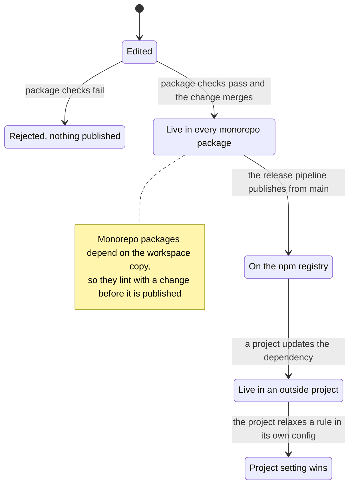

# @nextnode-solutions/standards

The shared tool configuration of NextNode projects. It ships one preset per tool, from the linter and formatter to the TypeScript, test, commit and release configs, and `nextnode`, an oxlint plugin that turns the NextNode coding guidelines into lint rules. A config copied into each repository drifts, so every NextNode project extends these presets instead.

## Quick start

Install the package with its linter and formatter, which every project needs, and the type-aware lint backend:

```sh
pnpm add -D @nextnode-solutions/standards oxlint oxfmt oxlint-tsgolint
```

Extend the lint preset in `oxlint.config.ts`:

```ts
import standardsConfig from '@nextnode-solutions/standards/oxlint'
import { defineConfig } from 'oxlint'

export default defineConfig({
	extends: [standardsConfig],
})
```

Forward the formatter preset in `oxfmt.config.ts`:

```ts
export { default } from '@nextnode-solutions/standards/oxfmt'
```

Lint with type information, so the preset's type-aware rules run too:

```json
{
	"scripts": {
		"lint": "oxlint --type-aware",
		"format": "oxfmt --write ."
	}
}
```

Every other preset follows the same pattern. Its export subpath is `@nextnode-solutions/standards/<tool>`, or `@nextnode-solutions/standards/<tool>/<kind>` when the tool has one preset per project kind, as in `typescript/library`. The `exports` map in `package.json` lists them all. The [configuration guide](docs/configuration.md) shows how a project wires each one and how it overrides a preset.

## How a preset change reaches a project



A project uses a preset in this order:

1. The project's tool config imports or extends a preset by its export subpath.
2. The tool loads the preset from `node_modules`. Every preset is a plain file that needs no build in the project.
3. For the lint preset, oxlint also loads the `nextnode` plugin that the preset points at, and runs the native and custom rules the preset enables.
4. The project's own settings apply on top of the preset, and an inline disable comment applies on top of both for one line.

The [architecture guide](docs/architecture.md) explains how the lint preset, the plugin and its test harness fit together, and how to read a custom rule.

## Release

semantic-release versions and publishes the package from conventional commits, through the shared package pipeline described in the [root README](../../README.md). This package's `nextnode.toml` configures that pipeline.

## Contributing

[AGENTS.md](AGENTS.md) holds the rules and the steps for adding a rule or a preset. The monorepo rules are in the [root AGENTS.md](../../AGENTS.md).
