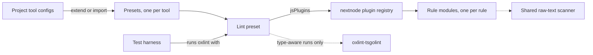
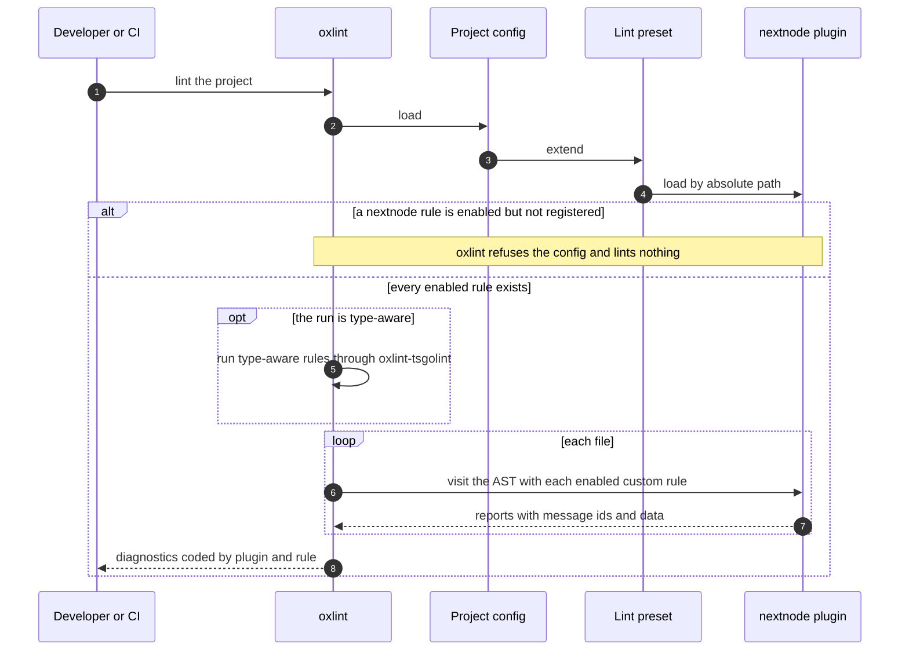
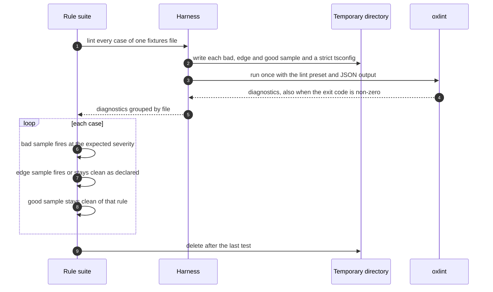
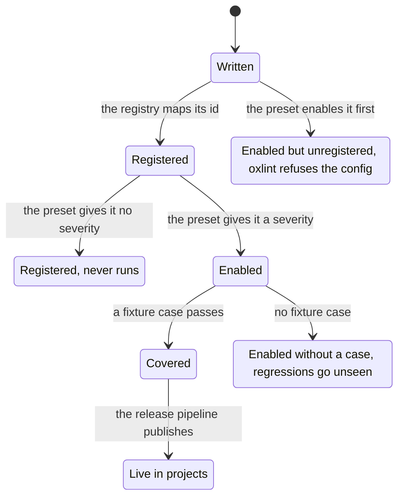

# Architecture

How the package is split, what crosses each boundary, how to read a custom lint rule, and what happens during a lint run and a test run.

## Parts



Every preset is a plain file that an export subpath points at. Most are read as they are. The lint preset is where the logic lives. It enables native oxlint plugins, rule categories and individual rules, loads the `nextnode` plugin, and declares overrides for file types. The plugin registry maps each custom rule id to its rule module. The test harness lints sample code through the lint preset, exactly as a project does.

## Boundaries

### Project and preset

A JavaScript preset default-exports its config object. When projects import it from a TypeScript config file, a declaration file beside it types that export with the upstream tool's config type. Projects spread or merge these objects, so the declared shape is part of the contract. The formatter preset's declaration promises `ignorePatterns`, which projects spread to add their own. JSON presets are extended by path, the CSS theme is imported, and the dotfile presets are copied. The [configuration guide](configuration.md) shows each one from the project side.

### Lint preset and plugin

The lint preset passes the plugin to oxlint through `jsPlugins` as an absolute path, resolved from the preset's own location. oxlint then finds the plugin wherever the project's config lives. The preset gives each custom rule a severity under the `nextnode/` prefix. A rule runs only when the registry maps it and the preset enables it. Rule modules never choose their own severity, so a project overrides one place and the preset stays the single default.

### Registry and rule module

The registry imports every rule module and maps the rule id to the rule object. A rule module's file name is its rule id, and it exports the rule object as a named constant in camelCase. Rule modules import only shared helpers from the plugin directory, never another rule or the registry.

### Rule module and oxlint

A rule module follows the oxlint JS plugin API, which mirrors ESLint's. This is the rule that bans `enum` declarations, without its exemption, each text replaced by what it holds:

```js
/**
 * What the rule forbids, why, what stays allowed, and how to fix it.
 */
export const noEnum = {
	meta: {
		type: 'problem',
		docs: {
			description: 'One line that summarizes the rule',
		},
		messages: {
			noEnum: 'What is wrong and what to write instead.',
		},
		schema: [],
	},
	create(context) {
		return {
			TSEnumDeclaration(node) {
				context.report({ node, messageId: 'noEnum' })
			},
		}
	},
}
```

Read a rule in this order:

1. The header comment is the rule's documentation. It states the guideline, the reason, the exemptions and any sanctioned per-line opt-out.
2. `meta.type` says whether the rule catches likely bugs, `problem`, or shapes the code, `suggestion`.
3. `meta.messages` maps each message id to the text a developer sees. Placeholders such as `{{name}}` take their values from the `data` of the report. Every message says what to write instead.
4. `meta.schema` is empty. Custom rules take no options. A threshold or a word list lives as a named constant at the top of the module, so every project gets the same standard.
5. `meta.fixable` appears only on a rule whose reports carry a `fix`.
6. `create(context)` returns a visitor keyed by AST node type. Small helpers above the rule object keep each visitor short. A rule that depends on the file name reads `context.filename` and returns an empty visitor for files it ignores. A rule that decides once per file reports from `Program:exit`.
7. `context.sourceCode` gives the source text, scopes and declared variables when the AST alone is not enough.

A rule that bans a character anywhere in a file cannot rely on AST hooks, because no hook covers comments, strings and template literals at once. It walks the raw source text through the shared scanner, with a fresh global regular expression on each call, since a global expression keeps its position between calls.

Every custom rule is syntactic. It reads the AST, scopes and text. Checks that need type information are native rules run with `--type-aware`.

The fixture case for a rule completes its header comment. Its bad, edge and good samples show what fires and what stays clean.

### Overrides by file type

The overrides in the lint preset apply rule changes to files matched by globs. Each block exists for one reason, stated in a comment or obvious from its globs, such as test files that need no size limits or framework entry points that must default-export. A project adds its own blocks the same way.

### Test harness and oxlint

The harness writes the samples of one fixtures file to a fresh temporary directory, next to a strict `tsconfig.json`, and runs the oxlint binary once over that directory. It passes the lint preset as the config, asks for JSON output, and adds `--type-aware` for the type-aware suite. oxlint exits non-zero when it finds errors, and the harness still reads the report from standard output. A report it cannot parse makes it throw.

## A lint run in a project



A diagnostic code names the plugin and the rule, as in `nextnode(no-enum)`. For most native plugins the printed name differs from the prefix used in the config, as `typescript/` rules print as `typescript-eslint(...)`.

## A test run



Native rules, custom rules and type-aware rules each have their own fixtures file, and a short test file hands each list to the rule suite. A case names the diagnostic code that oxlint prints and the severity it prints. It holds three samples. The bad sample must fire. The edge sample covers a tricky variant and declares whether it fires. The good sample must stay clean of that rule. Assertions look only at the case's own rule, so other rules may fire on the same sample.

Sample file names derive from the diagnostic code. A case sets its own names when the rule reads the file name, when an override glob must match, or when its rule already has another case.

The tests never import a rule module. A passing case therefore also proves that the rule is registered and enabled. A separate non-functional suite lints whole modules. It checks that the preset loads without an unknown rule or plugin, that code written to the guidelines yields no diagnostic at all, that the resolved rule count stays above a floor, and that a run stays within a time budget.

## The lifecycle of a custom rule



## Failure and what is left

| Failure                                                              | What is left                                                                      |
| -------------------------------------------------------------------- | --------------------------------------------------------------------------------- |
| A custom rule is enabled in the preset but missing from the registry | oxlint refuses the config. Every project that extends that version lints nothing. |
| A custom rule is registered without a severity                       | The rule never runs, and no test notices unless a fixture case exists.            |
| A rule fires on code written to the guidelines                       | The non-functional suite fails when its sample module triggers the rule.          |
| Two fixture cases share sample file names                            | One sample overwrites the other, and a case tests the wrong code.                 |
| A project lints without `--type-aware`                               | Type-aware rules are skipped, and nothing reports it.                             |
| oxlint prints output the harness cannot parse                        | The harness throws, and the whole suite fails before any case runs.               |

## Guarantees

1. Every preset loads from a project's `node_modules` with no build in the project.
2. The lint preset loads without an unknown rule or plugin.
3. Code written to the NextNode guidelines yields no diagnostic, not even a warning.
4. Each tested rule is tested through the lint preset, as projects run it.
5. Monorepo packages pick up a change without a release, because they depend on the workspace copy.
