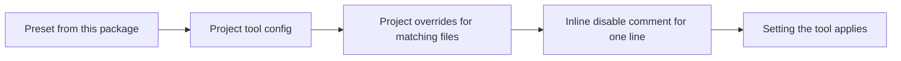

# Configuration

How a project wires each preset into its tool configs, which setting wins when the project and the preset disagree, and how a wiring mistake shows up.

## Which setting wins



Each step overrides the one before it. A project never edits a preset. It extends the preset and changes what it needs in its own config. A rule the project relaxes stays in force for every other project.

Every preset is an export subpath of this package. The subpath names the tool, and adds the project kind when the tool has one preset per kind. The `exports` map in `package.json` is the full list. Each tool looks for its config file at the project root under the name shown in each section below.

The package declares most tools behind its presets as peer dependencies, and `peerDependenciesMeta` marks which are optional. Install the tool behind every preset you use. Each section below names what else a project installs.

## Linting

```ts
// oxlint.config.ts
import standardsConfig from '@nextnode-solutions/standards/oxlint'
import { defineConfig } from 'oxlint'

export default defineConfig({
	extends: [standardsConfig],
	rules: {
		'eslint/no-console': 'off',
	},
	overrides: [
		{
			files: ['**/*.spec.ts', '**/*.test.ts'],
			rules: {
				'unicorn/consistent-function-scoping': 'off',
			},
		},
	],
})
```

Turn a rule off or change its severity in `rules`. Scope a change to some files with `overrides`. Custom rules use the `nextnode/` prefix, and their options cannot change.

Some native rules need type information. oxlint runs them only with `--type-aware`, through the `oxlint-tsgolint` peer. Put the flag in the project's `lint` script. Without it, oxlint skips those rules silently and runs the rest.

A custom rule that allows a per-line opt-out names the disable comment to write in its own documentation. Every other finding means the code changes.

## Formatting

```ts
// oxfmt.config.ts
export { default } from '@nextnode-solutions/standards/oxfmt'
```

The preset always declares `ignorePatterns`, so a project adds its own patterns by spreading it:

```ts
// oxfmt.config.ts
import baseConfig from '@nextnode-solutions/standards/oxfmt'

export default {
	...baseConfig,
	ignorePatterns: [...baseConfig.ignorePatterns, 'generated/**'],
}
```

The preset keeps oxfmt away from `package.json`. The staged-files preset sorts that file with `better-sort-package-json`, and the two tools disagree on key order, so running both would rewrite it on every commit.

## TypeScript

```json
{
	"extends": "@nextnode-solutions/standards/typescript/library",
	"compilerOptions": {
		"types": ["node"]
	},
	"include": ["src"],
	"exclude": ["node_modules", "dist"]
}
```

Pick the variant that matches the project kind. A variant sets strictness and module options and never emits, because bundling belongs to the bundler. The project's `tsconfig.json` adds `include`, `paths`, `types` and any `lib` it needs.

## Bundling

```ts
// tsdown.config.ts
import baseConfig from '@nextnode-solutions/standards/tsdown'
import { defineConfig } from 'tsdown'

export default defineConfig({
	...baseConfig,
	entry: 'src/index.ts',
	dts: false,
})
```

The preset sets the output format and target. The project adds its entries and decides whether to emit declarations.

## Tests

The backend and frontend presets are plain Vitest configs. Merge the project's settings into them in `vitest.config.ts`:

```ts
// vitest.config.ts
import baseConfig from '@nextnode-solutions/standards/vitest/backend'
import { defineConfig, mergeConfig } from 'vitest/config'

export default mergeConfig(
	baseConfig,
	defineConfig({
		test: {
			include: ['src/**/*.{test,spec}.ts'],
		},
	}),
)
```

The frontend preset runs tests in jsdom, so the project installs `jsdom`.

The Astro preset is built with Astro's `getViteConfig`, which returns a config function. `mergeConfig` cannot merge a function, so re-export the preset as it is:

```ts
// vitest.config.ts
export { default } from '@nextnode-solutions/standards/vitest/astro'
```

When pnpm installs two Vite majors side by side, Vitest's `test` key reaches the types of only one. Add this reference at the top of the Vite or Vitest config to apply it to both:

```ts
/// <reference types="@nextnode-solutions/standards/vitest/vite-plugin" />
```

## Commit messages

```js
// commitlint.config.js
export { default } from '@nextnode-solutions/standards/commitlint'
```

The project installs `@commitlint/cli` and `@commitlint/config-conventional`, and runs commitlint from its `commit-msg` hook.

## Staged files

```js
// lint-staged.config.js
export { default } from '@nextnode-solutions/standards/lint-staged'
```

The preset lints and formats staged sources with oxlint and oxfmt, and sorts `package.json` with `better-sort-package-json`. The project installs `lint-staged` and `better-sort-package-json`, and runs lint-staged from its `pre-commit` hook.

## Releases

```json
{
	"extends": [
		"semantic-release-monorepo",
		"@nextnode-solutions/standards/semantic-release"
	],
	"tagFormat": "@nextnode-solutions/logger-v${version}"
}
```

The preset in `.releaserc.json` publishes to npm and creates a GitHub release without success comments or failure issues. A package inside a monorepo lists `semantic-release-monorepo` first and puts its own name in `tagFormat`. A repository with a single package drops `semantic-release-monorepo`. The project installs `semantic-release`. This package brings the GitHub and monorepo plugins with it.

## Tailwind CSS

```css
@import 'tailwindcss';
@import '@nextnode-solutions/standards/tailwind';
```

The theme holds brand-neutral `@theme` tokens. Brand colors and fonts stay in the project.

## EditorConfig and npm settings

EditorConfig and `.npmrc` cannot extend another file. Copy the presets to the project root:

```sh
cp "$(node -p "require.resolve('@nextnode-solutions/standards/editorconfig')")" .editorconfig
cp "$(node -p "require.resolve('@nextnode-solutions/standards/npmrc')")" .npmrc
```

Copy them again after an update that changes them.

## How mistakes show up

| Mistake                                                     | What the project sees                                                                                           |
| ----------------------------------------------------------- | --------------------------------------------------------------------------------------------------------------- |
| A wrong export subpath, or a missing peer                   | The tool fails to load its config with a module resolution error.                                               |
| A `nextnode/` rule that the installed version does not have | oxlint refuses the config and reports that the rule is not found in the `nextnode` plugin. Nothing gets linted. |
| A lint script without `--type-aware`                        | The type-aware rules never run, and nothing reports it.                                                         |
| Merging the Astro test preset with `mergeConfig`            | Vite rejects the merge, because the preset is a config function.                                                |
| A stale copy of the EditorConfig or npm preset              | Nothing fails. The project keeps the old settings until it copies the files again.                              |
