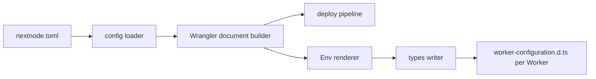

# @nextnode-solutions/worker-types

`worker-types` writes a `worker-configuration.d.ts` for each Cloudflare Worker an app declares in its `nextnode.toml`, so `import { env } from 'cloudflare:workers'` is typed with the bindings and vars that the NextNode deploy pipeline gives that Worker. The types come from the same Wrangler configuration the deploy builds, so a binding cannot be deployed without being typed, and a typed binding cannot be missing from the deploy.

The generation itself belongs to the [infrastructure package](../infrastructure/README.md), which is not published. This package is the published command that carries it.

## Quick start

Install it as a dev dependency of the app that holds `nextnode.toml`:

```bash
pnpm add -D @nextnode-solutions/worker-types
```

Run it before the scripts that need the types:

```jsonc
// package.json
{
	"scripts": {
		"prebuild": "worker-types gen",
		"pretype-check": "worker-types gen",
	},
}
```

Keep the output out of git:

```gitignore
# generated, not committed
worker-configuration.d.ts
```

The generated file references `@cloudflare/workers-types`, so the app needs that package for its type-checker.

## Command

```text
worker-types [gen] [--config PATH]
```

- `gen` generates the files. It also runs when no command is given.
- `--config PATH` names the `nextnode.toml` to read. Without it, the command reads `nextnode.toml` in the current directory.

Each Worker under `[deploy.services]` gets one file, written into the nearest directory above its `entry` that holds a `package.json`. In a monorepo that is the app's package directory. The entry file may be absent, because the command only walks up its path. A static-assets-only Worker, `entry = false`, has no script and gets no file. A project that does not deploy, such as `type = "package"`, gets nothing and the command still succeeds.

## How it works



1. The command hands the config path to the generation entry of the infrastructure package.
2. The infrastructure config loader parses and validates `nextnode.toml`, as it does for every pipeline command.
3. For each Worker with a script, the renderer builds the Worker's Wrangler document with placeholder resource ids, because the types need only the binding and var names.
4. The renderer turns every binding into a member typed with its Cloudflare runtime type, and every public var into a `string` member. A sibling Worker listed in `needs` is a `Fetcher`. Members are sorted by name, so the file is stable between runs.
5. The writer finds the app's package directory above the entry and writes the file there.

The file merges these members into the `Cloudflare.Env` interface that `@cloudflare/workers-types` ships, then declares `interface Env extends Cloudflare.Env` for code that names `Env`.

The infrastructure CLI runs the same generation as its `generate-worker-types` command. Both produce the same file.

## Secrets and internal services

Secrets come from the repository's Infisical project, not from `nextnode.toml`, so the command never declares them. Type the secrets your code reads by augmenting `Cloudflare.Env` in a declaration file of your app that has no `import` or `export`:

```ts
declare namespace Cloudflare {
	interface Env {
		readonly STRIPE_SECRET_KEY: string
	}
}
```

An internal Worker also gets `ACCESS_AUD`, the audience tag the deploy injects so the Worker can verify the Cloudflare Access JWT. A Worker is internal when it has a `url` and sets `internal = true`, or inherits `project.internal`.

## Failures

The command logs one error line and exits with code 1.

| Failure                                         | What is left                                                                 |
| ----------------------------------------------- | ---------------------------------------------------------------------------- |
| The config file does not exist                  | Nothing is written                                                           |
| `nextnode.toml` fails validation                | Nothing is written. The message lists every validation error.                |
| An unknown command is given                     | Nothing is written. The message shows the usage line.                        |
| No `package.json` exists above a Worker's entry | Files written for the Workers before it stay. The Workers after it get none. |

## Contributing

[AGENTS.md](AGENTS.md) holds the rules for changing this package: where a change to the generated types goes, how to build and check it, and how a change reaches a release. The [root README](../../README.md) covers the monorepo.
